[⬅ Back to README](../../../README.md)

<div align="center">
  <br>
  <h1 style="margin-top: 0;">Introduction to 3D Modeling</h1>
</div>

3D modeling is the process of building objects, characters, and environments in three-dimensional space, then texturing, lighting, and rendering them into still images or animations. It powers video games, film and TV visual effects, product visualization, architecture, and 3D printing. This Topic covers the fundamentals behind 3D work: how models are built from meshes, how materials and lighting create realism, and how a finished scene is rendered and exported.

These lessons intentionally avoid tying the concepts to a single program. Once you understand the fundamentals here, head to the tool-specific files below to see how they are put into practice with real software.

### Why Learn 3D Modeling?

- **It's used across many industries** — games, film, architecture, product design, medicine, and manufacturing all rely on 3D assets.
- **It combines art and technical thinking** — you learn form and composition alongside geometry and optimization.
- **It's easy to start for free** — Blender offers a complete professional pipeline at no cost.
- **Skills transfer between tools** — meshes, UVs, materials, and rendering are the same ideas in nearly every 3D package.

A quick sense of the most common ways to build a 3D model:

| Approach | How It Works | Best For |
|---|---|---|
| Polygon modeling | Build shapes from vertices, edges, and faces | Hard-surface objects, game assets |
| Sculpting | Push and pull a dense mesh like digital clay | Characters, creatures, organic forms |
| Procedural / nodes | Generate geometry from rules and parameters | Terrain, patterns, variations |
| CAD modeling | Define exact dimensions and constraints | Engineering and manufacturing parts |

### Tools:

The lessons below teach the fundamentals that apply across 3D software. To see those fundamentals applied to a specific tool, continue on to:

<table align="center" width="100%" style="margin-left:auto;margin-right:auto;table-layout:fixed;"> <tr><th align="center" width="25%">Tool</th><th align="center" width="75%">Description</th></tr> <tr> <td align="center" width="25%" height="100"><a href="./Blender.md"><br>Blender</a></td> <td align="left" width="75%">Free, open-source suite for modeling, sculpting, animation, simulation, and rendering.</td> </tr> </table>

---

### Table of Contents

**Basics**

   1. **[What Is 3D Modeling](#lesson-1---what-is-3d-modeling)**  
       1.1 Defining 3D Modeling  
       1.2 Vertices, Edges, and Faces  
       1.3 Coordinate Space and Units  
       1.4 Common Use Cases  
   2. **[Meshes And Topology](#lesson-2---meshes-and-topology)**  
       2.1 Polygons, Triangles, and Quads  
       2.2 Clean Topology and Edge Flow  
       2.3 Polygon Count and Performance  
       2.4 Normals and Shading  
   3. **[Building Models](#lesson-3---building-models)**  
       3.1 Polygon Modeling  
       3.2 Sculpting  
       3.3 Modifiers and Non-Destructive Workflows  
       3.4 Reference Images and Blocking Out  

**Look And Output**

   4. **[Materials And Textures](#lesson-4---materials-and-textures)**  
       4.1 UV Mapping  
       4.2 Image Textures and Procedural Textures  
       4.3 Materials and Shaders  
       4.4 PBR Workflow  
   5. **[Lighting Cameras And Rendering](#lesson-5---lighting-cameras-and-rendering)**  
       5.1 Types of Lights  
       5.2 Camera Settings and Composition  
       5.3 Real-Time vs Path-Traced Rendering  
       5.4 Render Settings and Output  

**Ecosystem**

   6. **[Animation And Rigging Basics](#lesson-6---animation-and-rigging-basics)**  
       6.1 Keyframes and Timelines  
       6.2 Armatures and Rigging  
       6.3 Weight Painting  
       6.4 Simple Animation Workflow  
   7. **[Choosing A 3D Tool](#lesson-7---choosing-a-3d-tool)**  
       7.1 Modeling vs Sculpting vs CAD  
       7.2 Free vs Paid Software  
       7.3 Exporting to Games and 3D Printing  
       7.4 Where to Go Next  

---

*Basics*

## Lesson 1 - What Is 3D Modeling

### 1.1 Defining 3D Modeling

3D modeling means creating a digital object with width, height, and depth that can be viewed from any angle. The model describes shape; looks and motion are added afterward.

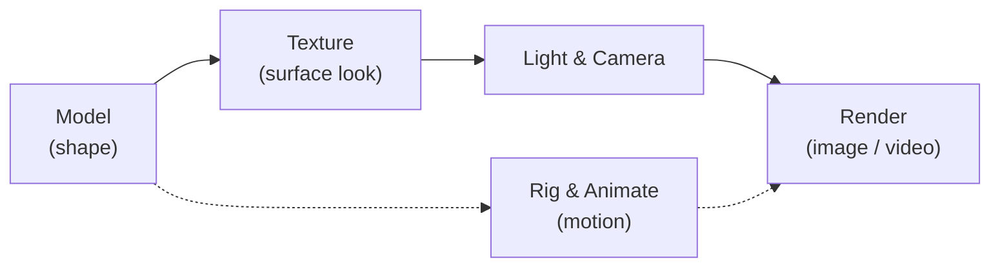

---

### 1.2 Vertices, Edges, and Faces

A vertex is a point in space, an edge connects two vertices, and a face is a flat surface enclosed by edges. Together they form a mesh, the basic building block of most 3D models.

```
   v1 ●━━━━━━━━━● v2        ● Vertex = a point
      ┃  FACE   ┃           ━ Edge   = line joining 2 vertices
      ┃ (quad)  ┃           ▢ Face   = surface enclosed by edges
   v4 ●━━━━━━━━━● v3
```

**Sample:** a plane stored as raw data (this is essentially what the OBJ file format looks like).

```text
v -1 0  1     # vertex 1
v  1 0  1     # vertex 2
v  1 0 -1     # vertex 3
v -1 0 -1     # vertex 4
f 1 2 3 4     # one quad face using those 4 vertices
```

| Count for a cube | Number |
|---|---|
| Vertices | 8 |
| Edges | 12 |
| Faces | 6 |

---

### 1.3 Coordinate Space and Units

3D space uses X, Y, and Z axes. Objects have a location, rotation, and scale, and most software lets you set real-world units so a model's size makes sense when exported.

```
          Z (up)
          │
          │      Y (depth)
          │    ╱
          │  ╱
          │╱________ X (right)
         origin (0, 0, 0)
```

| Transform | Meaning | Example |
|---|---|---|
| Location | Where it is | `(2, 0, 1)` m |
| Rotation | How it's turned | `(0°, 0°, 90°)` |
| Scale | How big it is | `(1, 1, 1)` = original size |

> [!NOTE]
> Axis conventions differ: Blender and many CAD tools use **Z-up**, while Unity and many game engines use **Y-up**. Check this when exporting.

---

### 1.4 Common Use Cases

Games need efficient, low-polygon assets. Film and visualization favor detail and realism. Architecture and product design focus on accuracy, and 3D printing needs watertight, printable shapes.

| Industry | Priority | Typical polygon budget |
|---|---|---|
| Mobile / real-time games | Speed | A few thousand per prop |
| Film & VFX | Realism | Millions |
| Architecture / product viz | Accuracy | Moderate to high |
| 3D printing | Printable geometry | Moderate, must be watertight |

---

*Basics*

## Lesson 2 - Meshes And Topology

### 2.1 Polygons, Triangles, and Quads

Faces are made of polygons: triangles (three sides), quads (four sides), or n-gons (more). Quads are preferred for modeling because they subdivide and deform predictably, while game engines convert everything to triangles.

```
  Triangle (3)         Quad (4)           N-gon (5+)
      ▲                ┌─────┐             ⬠
     ╱ ╲               │     │            
    ▔▔▔▔▔              └─────┘           ❌ avoid: shades
   engine-ready      ✅ best for           and subdivides
                       modeling            unpredictably

  A quad = 2 triangles:   ┌───┐      ┌───┐
                          │   │  →   │╲  │
                          └───┘      └──╲┘
```

---

### 2.2 Clean Topology and Edge Flow

Topology is how a mesh's edges are arranged. Good edge flow follows the natural form of the object, such as loops around an eye or a joint, so surfaces smooth and bend without ugly pinching.

```
  ✅ Good: loops follow the form      ❌ Bad: random triangles & poles
        ╭───────────╮                      ╱╲  ╱╲  ╱╲
      ╭─┴─╮  ◉  ╭─┴─╮                    ╱  ╲╱  ╲╱  ╲
      │(  )│     │(  )│  rings around    ╲  ╱╲  ╱╲  ╱  pinches when
      ╰─┬─╯     ╰─┬─╯   the eye           ╲╱  ╲╱  ╲╱   the surface bends
        ╰───────────╯
```

> [!TIP]
> Rule of thumb: add edge loops where something **bends or has detail**, and keep flat areas simple.

---

### 2.3 Polygon Count and Performance

More polygons mean more detail but also slower viewports, longer renders, and heavier game assets. Model only as much detail as the final use needs, and use textures or normal maps to fake fine detail.

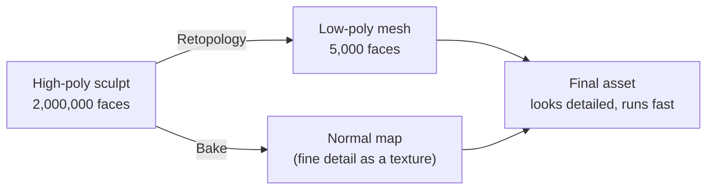

| Level of detail (LOD) | Used when | Example faces |
|---|---|---|
| LOD0 | Close to camera | 10,000 |
| LOD1 | Medium distance | 4,000 |
| LOD2 | Far away | 1,000 |

---

### 2.4 Normals and Shading

Normals are directions that tell the renderer which way a face points. Flipped normals cause dark or invisible faces. Smooth shading blends lighting across faces, while flat shading shows each face separately.

```
   Correct normals                Flipped normal
   ↑   ↑   ↑                      ↑   ↓   ↑
 ──────────────  surface         ──────────────
   lit properly                    dark / invisible face

   Flat shading        Smooth shading
   ▁▂▃▄▅ (faceted)     ╭────╮ (blended)
```

---

*Basics*

## Lesson 3 - Building Models

### 3.1 Polygon Modeling

Start with a simple shape and refine it with extrude, inset, bevel, and loop cuts. This is the standard approach for hard-surface objects like furniture, vehicles, and props.

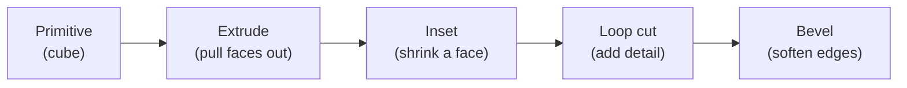

| Tool | What it does |
|---|---|
| Extrude | Pulls a face/edge out into new geometry |
| Inset | Creates a smaller face inside a face |
| Bevel | Rounds or chamfers sharp edges |
| Loop cut | Adds a ring of edges around the mesh |

---

### 3.2 Sculpting

Sculpting pushes, pulls, and smooths a dense mesh like clay. It suits organic forms such as characters and creatures, and the result is often retopologized into a cleaner, lighter mesh.

| Brush | Effect |
|---|---|
| Draw | Raise or lower the surface |
| Smooth | Relax bumps |
| Grab | Move large areas |
| Crease | Cut sharp lines (wrinkles, folds) |
| Clay strips | Build up mass quickly |

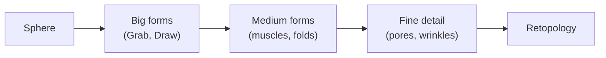

---

### 3.3 Modifiers and Non-Destructive Workflows

Modifiers (mirror, subdivision, array, bevel) apply changes without permanently altering the mesh. Keeping them adjustable lets you revise a design late in the process.

```
  Base mesh (8 faces)  →  Mirror  →  Subdivision  →  Final (smooth, symmetric)
      ┌─┐                  ┌─┬─┐       ╭──┬──╮            ╭────╮
      │ │      ───►       │ │ │  ───► │  │  │   ───►     │    │
      └─┘                  └─┴─┘       ╰──┴──╯            ╰────╯
   You only model one half; modifiers do the rest and stay editable.
```

**Sample:** adding modifiers with Python (Blender-style scripting).

```python
import bpy

obj = bpy.context.active_object
obj.modifiers.new(name="Mirror", type='MIRROR')
sub = obj.modifiers.new(name="Subdivision", type='SUBSURF')
sub.levels = 2          # viewport smoothness
```

---

### 3.4 Reference Images and Blocking Out

Gather reference images first, then block out the overall proportions with simple shapes before adding detail. Getting the big forms right early saves a lot of rework.

```
  Reference         Blockout (primitives)       Detailed model
  ☕ mug photo  →    ▭ cylinder + ◠ torus   →    handle, rim, bevels
                   (check proportions)          (only after proportions are right)
```

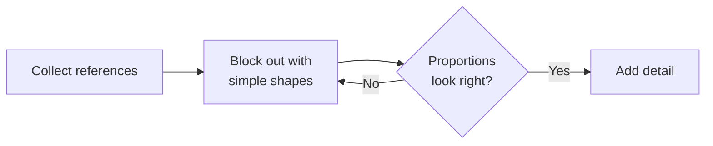

---

*Look And Output*

## Lesson 4 - Materials And Textures

### 4.1 UV Mapping

UV mapping unfolds a 3D surface into a flat 2D layout so images can be wrapped onto it. Clean seams and even texel density keep textures from stretching.

```
   3D cube                 Unwrapped UV layout (flat)
    ┌───┐                       ┌───┐
   ╱ top╲╲                      │top│
  ┌───┬───┐               ┌───┬───┼───┬───┐
  │ F │ R │      ───►     │ L │ F │ R │ B │
  └───┴───┘               └───┴───┼───┴───┘
                                  │bot│
                                  └───┘
  U = horizontal (0→1)   V = vertical (0→1)
```

> [!TIP]
> Place seams where they are hard to see (under objects, along natural edges). A checkerboard test texture reveals stretching instantly.

---

### 4.2 Image Textures and Procedural Textures

Image textures are painted or photographed pictures applied to a model. Procedural textures are generated by math, so they have no fixed resolution and can be tweaked with sliders.

| | Image texture | Procedural texture |
|---|---|---|
| Source | Photo / painted image | Math / nodes |
| Resolution | Fixed (e.g. 2048 px) | Infinite |
| Needs UVs | Yes | Usually no |
| Best for | Unique detail (labels, faces) | Noise, wood, marble, rust |

---

### 4.3 Materials and Shaders

A material defines how a surface reacts to light: color, roughness, metalness, transparency, and glow. A shader is the program that calculates that response.

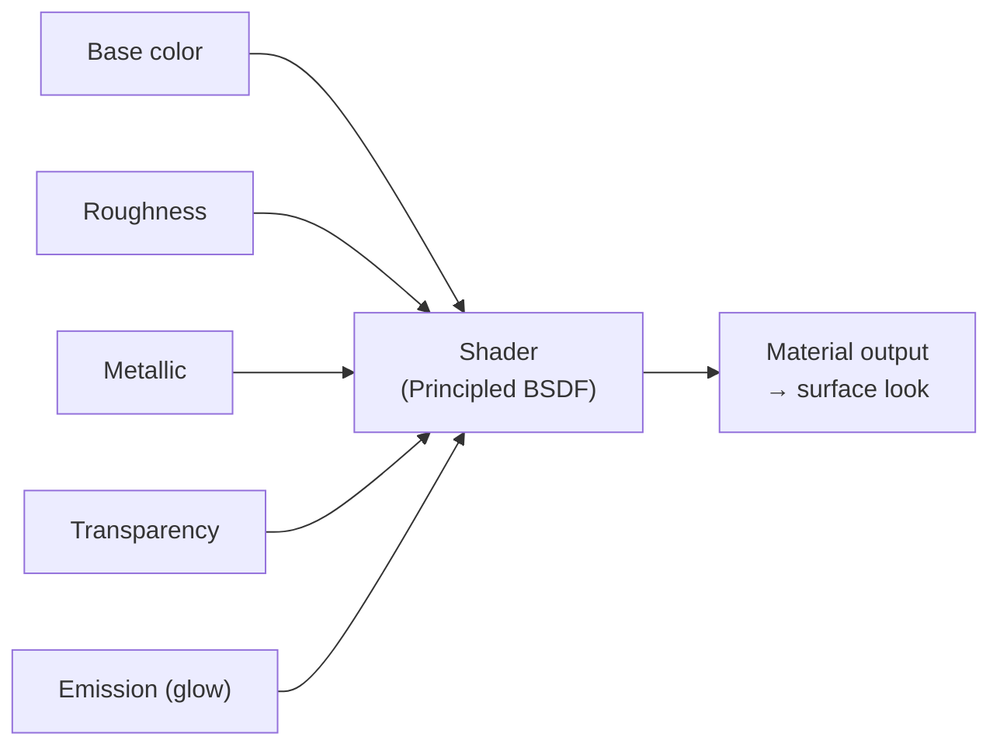

| Material | Color | Roughness | Metallic |
|---|---|---|---|
| Polished gold | Yellow | 0.1 | 1.0 |
| Rubber | Dark gray | 0.9 | 0.0 |
| Glossy plastic | Any | 0.2 | 0.0 |

---

### 4.4 PBR Workflow

Physically based rendering uses maps such as base color, roughness, metallic, and normal to describe a surface. Because PBR follows real-world light behavior, materials look consistent across different engines and lighting.

| Map | Controls | Color space |
|---|---|---|
| Base Color (Albedo) | Surface color, no lighting baked in | sRGB |
| Roughness | Shiny (black) ↔ matte (white) | Non-color |
| Metallic | Non-metal (black) ↔ metal (white) | Non-color |
| Normal | Fake fine bumps | Non-color |
| Ambient Occlusion | Soft contact shadows | Non-color |

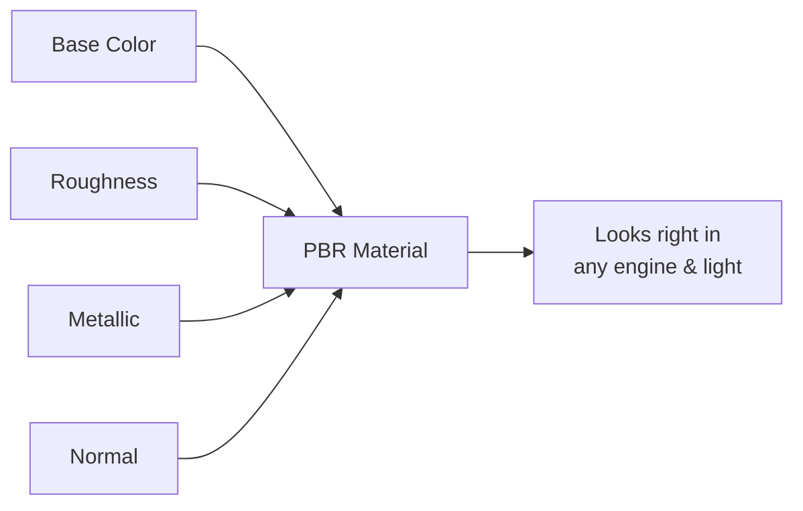

---

*Look And Output*

## Lesson 5 - Lighting Cameras And Rendering

### 5.1 Types of Lights

Common lights are point, spot, sun (directional), and area lights. Many scenes also use an HDRI environment image for realistic ambient light and reflections.

```
  Point        Spot         Sun            Area
    ✦         ╲  ▼  ╱      ↘ ↘ ↘ ↘        ┌───────┐
  ↙ ↓ ↘        ╲ ▼ ╱       ↘ ↘ ↘ ↘        │ ▒▒▒▒▒ │
 all directions  cone      parallel rays    └─↓─↓─↓─┘
 (bulb)        (flashlight) (sunlight)      soft panel light
```

> [!TIP]
> **Three-point lighting:** Key light (main, brightest) + Fill light (softens shadows) + Rim/back light (separates subject from background).

```
            Rim ✦
                ╲
   Fill ✦        ◉ subject        ✦ Key
         ╲      ╱
          ╲    ╱
          📷 camera
```

---

### 5.2 Camera Settings and Composition

Focal length changes perspective, depth of field blurs the background, and framing guides the viewer's eye. The same composition rules from photography and 2D design apply.

| Focal length | Look | Use |
|---|---|---|
| 24 mm | Wide, dramatic perspective | Interiors, environments |
| 50 mm | Natural, human-eye feel | General scenes |
| 85 mm | Flattering, compressed | Portraits, characters |
| 135 mm+ | Very compressed | Product close-ups |

| Aperture (f-stop) | Depth of field |
|---|---|
| f/1.8 | Very blurry background |
| f/5.6 | Balanced |
| f/16 | Everything sharp |

---

### 5.3 Real-Time vs Path-Traced Rendering

Real-time renderers draw images instantly and suit games and previews. Path tracers simulate how light bounces and give more realistic results, but take longer per frame.

| | Real-time (rasterization) | Path tracing |
|---|---|---|
| Speed | 30–120+ fps | Seconds to hours per frame |
| Realism | Good (approximated) | Excellent (physically simulated) |
| Typical use | Games, viewport, AR/VR | Film, product renders, archviz |
| Examples | Eevee, Unreal, Unity | Cycles, Arnold, V-Ray |

```
  Path tracing: a ray bounces around the scene to find its color
  📷 ───► ▢ wall ───► ▢ floor ───► ☀ light
         (bounce 1)   (bounce 2)    (adds light to the pixel)
```

---

### 5.4 Render Settings and Output

Choose a resolution, sample count, and file format. Use more samples or denoising to reduce grain, and render to PNG or EXR if you plan to edit the image afterward.

| Setting | Draft / preview | Final |
|---|---|---|
| Resolution | 50% | 100% |
| Samples | 32–64 | 256–1024 |
| Denoise | On | On |
| Format | PNG / JPEG | PNG (stills), EXR (for editing), MP4 (animation) |

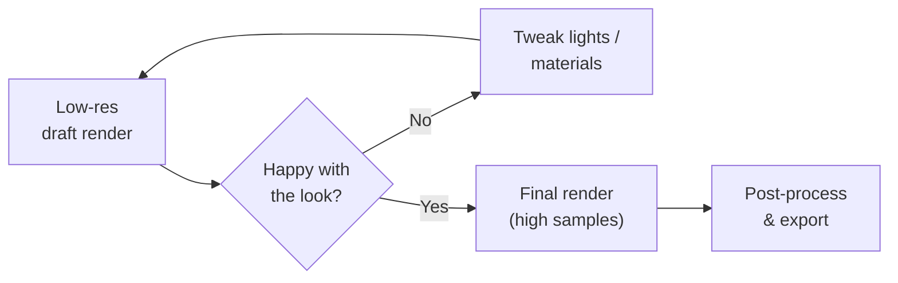

---

*Ecosystem*

## Lesson 6 - Animation And Rigging Basics

### 6.1 Keyframes and Timelines

Keyframes record a property, such as position or rotation, at specific frames, and the software fills in the motion between them. The timeline is where you place and adjust them.

```
 Frame:   1        12        24
          ◆─────────◆─────────◆      ◆ keyframe (you set these)
 Height:  0 m      2 m       0 m     ─ in-between frames (computer fills in)

 Timeline  |◆········◆········◆|  ▶ 24 fps = 1 second
```

---

### 6.2 Armatures and Rigging

An armature is a skeleton of bones placed inside a model. Rigging connects the model to the bones and adds controls so a character can be posed easily.

```
        ◯ head
        │
   ─────●───── shoulders        Bone hierarchy
        │                       Hips (root)
        ●  spine                 └─ Spine
       ╱ ╲                          ├─ Neck → Head
      ●   ●  hips                   ├─ L Arm → Forearm → Hand
      │   │                         └─ R Arm → Forearm → Hand
      ●   ●  knees               └─ L Leg → Shin → Foot
```

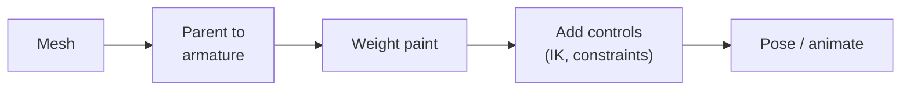

---

### 6.3 Weight Painting

Weight painting defines how strongly each bone influences nearby vertices. Good weights make joints bend smoothly instead of collapsing or stretching.

```
  Elbow weights (red = 100% upper arm, blue = 100% forearm)

  upper arm ████████▓▓▒▒░░░░░░░░ forearm
            red    →  blend  →  blue
                      ▲
              smooth gradient = smooth bend
```

---

### 6.4 Simple Animation Workflow

Plan the motion, block out key poses, add in-between frames, then refine timing and easing. A bouncing ball is the classic first exercise.

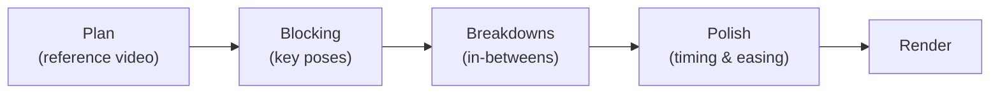

```
 Bouncing ball (key poses)
 f1 ●          f12 ●             ● = ball position
    ╲            ╱ ╲             Spacing: close together at the top,
     ╲          ╱   ╲            wide apart near the floor (gravity).
      ╲        ╱     ╲
 ──────●──────●───────●──────  floor (squash on contact)
      f6     f18     f30
```

---

*Ecosystem*

## Lesson 7 - Choosing A 3D Tool

### 7.1 Modeling vs Sculpting vs CAD

Use polygon or sculpting tools for artistic work and CAD tools when exact dimensions matter. Some programs, like Blender, cover the artistic side in one package.

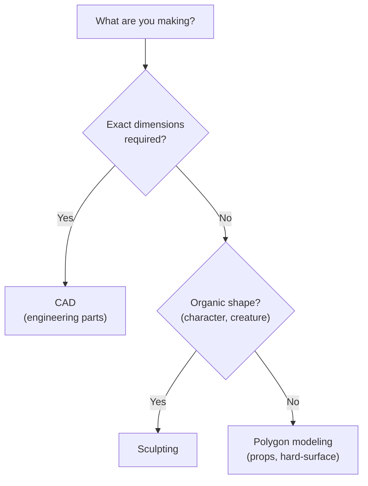

---

### 7.2 Free vs Paid Software

Blender is free and complete enough for professional work. Paid tools often offer specialized workflows or industry integration, but are not required to learn the fundamentals.

| Tool | Cost | Strength |
|---|---|---|
| Blender | Free | All-in-one: model, sculpt, animate, render |
| Maya / 3ds Max | Paid | Studio animation and VFX pipelines |
| ZBrush | Paid | High-end sculpting |
| Fusion / SolidWorks | Paid (some free tiers) | CAD and engineering |

---

### 7.3 Exporting to Games and 3D Printing

Games typically use FBX or glTF with optimized meshes and baked textures. 3D printing uses STL or 3MF and needs closed, manifold geometry with correct scale.

| Target | Format | Checklist |
|---|---|---|
| Game engine | glTF / FBX | Apply transforms, correct scale, UVs, baked textures |
| 3D printing | STL / 3MF | Watertight, no flipped normals, correct units (mm) |
| Web / AR | glTF / GLB | Low poly, compressed textures |

```
  ✅ Manifold (printable)        ❌ Non-manifold (will fail)
     ┌────────┐                     ┌────────┐
     │ closed │                     │  hole  │ ← gap in surface
     └────────┘                     └─ ─ ─ ──┘
```

---

### 7.4 Where to Go Next

Start with the Blender file in this topic and model a simple object such as a mug. From there, add materials, lighting, and a render, then try sculpting or animation.

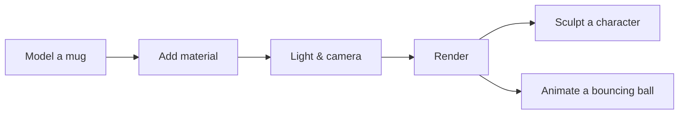