[⬅ Back to README](../../../README.md)

<div align="center">
  <br>
  <h1 style="margin-top: 0;">Introduction to Interfaces</h1>
</div>

Interface design is the practice of planning and building the screens people use to interact with websites, apps, and software. It combines layout, typography, color, and user-experience thinking so that a product is both easy to use and visually clear. This Topic covers the fundamentals of UI and UX design: how to move from an idea to wireframes, mockups, and interactive prototypes, how to build consistent components, and how to hand designs off to developers.

These lessons intentionally avoid tying the concepts to a single program. Once you understand the fundamentals here, head to the tool-specific file below to see how they are applied in practice.

### Why Learn Interface Design?

- **Good interfaces decide whether a product gets used** — even a powerful app fails if people can't figure it out.
- **It bridges design and development** — knowing how components, spacing, and responsive layouts work makes collaboration with developers smoother.
- **It's a core skill for product teams** — designers, front-end developers, and product managers all benefit from understanding it.
- **You can prototype without writing code** — modern tools let you test ideas with real users before anything is built.

A quick sense of the stages an interface design usually moves through:

| Stage | Purpose | Typical Fidelity |
|---|---|---|
| Sketch | Explore rough ideas quickly | Very low |
| Wireframe | Define structure and layout | Low (grayscale boxes) |
| Mockup | Add color, type, and imagery | High (visual design) |
| Prototype | Simulate clicks and navigation | High (interactive) |
| Handoff | Give developers specs and assets | Final |

### Tools:

The lessons below teach the fundamentals that apply across interface design tools. To see those fundamentals applied to a specific tool, continue on to:

<table align="center" width="100%" style="margin-left:auto;margin-right:auto;table-layout:fixed;"> <tr><th align="center" width="25%">Tool</th><th align="center" width="75%">Description</th></tr> <tr> <td align="center" width="25%" height="100"><a href="./Figma.md"><br>Figma</a></td> <td align="left" width="75%">Collaborative, browser-based tool for designing, prototyping, and handing off user interfaces.</td> </tr> </table>

---

### Table of Contents

**Basics**

   1. **[What Is Interface Design](#lesson-1---what-is-interface-design)**  
       1.1 Defining UI and UX  
       1.2 The Design Process  
       1.3 Wireframes, Mockups, and Prototypes  
       1.4 Usability and Accessibility Basics  
   2. **[Visual Foundations](#lesson-2---visual-foundations)**  
       2.1 Layout and Grids  
       2.2 Typography and Readability  
       2.3 Color and Contrast  
       2.4 Spacing, Alignment, and Hierarchy  
   3. **[Components And Design Systems](#lesson-3---components-and-design-systems)**  
       3.1 Buttons, Inputs, and Navigation  
       3.2 Reusable Components and Variants  
       3.3 Design Tokens  
       3.4 Building a Design System  

**Practice**

   4. **[Responsive And Adaptive Design](#lesson-4---responsive-and-adaptive-design)**  
       4.1 Breakpoints and Screen Sizes  
       4.2 Flexible Layouts  
       4.3 Mobile-First Thinking  
       4.4 Touch vs Pointer Interaction  
   5. **[Prototyping And Testing](#lesson-5---prototyping-and-testing)**  
       5.1 Linking Screens and Flows  
       5.2 Micro-Interactions and Transitions  
       5.3 Usability Testing  
       5.4 Gathering and Applying Feedback  

**Ecosystem**

   6. **[Collaboration And Handoff](#lesson-6---collaboration-and-handoff)**  
       6.1 Sharing and Commenting  
       6.2 Developer Handoff and Specs  
       6.3 Exporting Assets  
       6.4 Versioning and File Organization  
   7. **[Choosing An Interface Tool](#lesson-7---choosing-an-interface-tool)**  
       7.1 Matching Tools to Teams  
       7.2 Free vs Paid Plans  
       7.3 Building a Portfolio  
       7.4 Where to Go Next  

---

*Basics*

## Lesson 1 - What Is Interface Design

### 1.1 Defining UI and UX

UI (user interface) is what people see and touch: buttons, text, colors, and layouts. UX (user experience) is how the whole thing feels to use: whether tasks are easy, fast, and clear. A beautiful UI with poor UX still frustrates people, so the two always work together.

| | UI (looks) | UX (feels) |
|---|---|---|
| Question | "Does it look right?" | "Does it work well?" |
| Concerns | Color, type, icons, spacing | Flows, speed, clarity, errors |
| Example | A clean, well-colored checkout button | Checkout takes 3 steps instead of 8 |

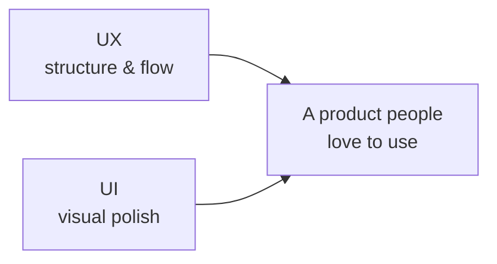

---

### 1.2 The Design Process

Most projects follow a loop: understand the users and their problem, sketch ideas, build wireframes and mockups, test with real people, and refine. Designs are rarely right the first time, so expect to repeat the loop.

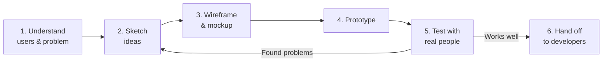

---

### 1.3 Wireframes, Mockups, and Prototypes

A wireframe is a low-detail layout that focuses on structure. A mockup adds color, type, and imagery to show the final look. A prototype links screens together so people can click through the flow before anything is built.

```
 WIREFRAME                MOCKUP                    PROTOTYPE
 ┌────────────────┐      ┌────────────────┐        ┌────────┐ tap ┌────────┐
 │ [logo]   ≡     │      │ 🟣 Acme    ☰   │        │ Login  │────►│ Home   │
 ├────────────────┤      ├────────────────┤        │ screen │     │ screen │
 │ ▭▭▭▭▭▭▭▭▭▭▭▭   │      │ ▓▓ Welcome ▓▓  │        └────────┘     └────────┘
 │ ░░░░░░░░░░     │      │ Sign in below  │        Clickable flow you can
 │ [ Button ]     │      │ [ Sign In ]🟣  │        test with real users
 └────────────────┘      └────────────────┘
 structure only          real colors & type
```

---

### 1.4 Usability and Accessibility Basics

Usable interfaces are clear, consistent, and forgiving of mistakes. Accessible interfaces also work for people with different abilities, through sufficient color contrast, readable text sizes, keyboard support, and meaningful labels.

| Principle | In practice |
|---|---|
| Clear | Plain labels: "Save changes", not "Submit" |
| Consistent | Same action looks and behaves the same everywhere |
| Forgiving | Undo, confirmations for destructive actions |
| Accessible | 4.5:1 text contrast, keyboard focus, alt text |

**Sample:** accessible markup basics.

```html
<button type="submit" aria-label="Search">
  <svg aria-hidden="true"><!-- magnifier icon --></svg>
</button>

<label for="email">Email address</label>
<input id="email" type="email" autocomplete="email" required>
```

---

*Basics*

## Lesson 2 - Visual Foundations

### 2.1 Layout and Grids

A grid divides a screen into columns and margins so elements line up consistently. A common choice is a 12-column grid on desktop and fewer columns on smaller screens.

```
 Desktop: 12 columns         Tablet: 8 columns       Mobile: 4 columns
 │▓│▓│▓│▓│▓│▓│▓│▓│▓│▓│▓│▓│    │▓│▓│▓│▓│▓│▓│▓│▓│       │▓│▓│▓│▓│
 └─┴─┴─┴─┴─┴─┴─┴─┴─┴─┴─┴─┘    └─┴─┴─┴─┴─┴─┴─┴─┘       └─┴─┴─┴─┘
 Card = 4 cols (3 per row)    Card = 4 cols (2 per row)   Card = 4 cols (1 per row)
```

**Sample:** the same idea in CSS.

```css
.grid {
  display: grid;
  grid-template-columns: repeat(12, 1fr);
  gap: 24px;
}
.card { grid-column: span 4; }          /* 3 cards per row */
@media (max-width: 600px) {
  .card { grid-column: span 12; }       /* 1 per row on phones */
}
```

---

### 2.2 Typography and Readability

Choose one or two typefaces and a clear size scale for headings, body text, and captions. Keep body text comfortably large, use adequate line spacing, and avoid very long lines.

| Style | Size | Weight | Line height |
|---|---|---|---|
| Heading 1 | 32 px | Bold | 40 px |
| Heading 2 | 24 px | Semibold | 32 px |
| Body | 16 px | Regular | 24 px (1.5×) |
| Caption | 12–13 px | Regular | 16 px |

> [!TIP]
> Aim for **45–75 characters per line** for comfortable reading.

---

### 2.3 Color and Contrast

Build a small palette with a main color, a neutral set, and a few state colors (success, warning, error). Make sure text has enough contrast against its background, and don't rely on color alone to carry meaning.

| Role | Example | Hex |
|---|---|---|
| Primary | Indigo | `#4F46E5` |
| Neutral (text) | Slate | `#1E293B` |
| Neutral (background) | Light gray | `#F8FAFC` |
| Success | Green | `#16A34A` |
| Warning | Amber | `#D97706` |
| Error | Red | `#DC2626` |

| Pair | Contrast ratio | WCAG AA (4.5:1) |
|---|---|---|
| `#1E293B` on `#FFFFFF` | ~14:1 | ✅ Pass |
| `#94A3B8` on `#FFFFFF` | ~2.6:1 | ❌ Fail |

> [!NOTE]
> Pair color with an icon or text. Red/green alone fails for color-blind users: add "✓ Saved" or "✕ Error".

---

### 2.4 Spacing, Alignment, and Hierarchy

Consistent spacing (often multiples of 4 or 8 pixels) makes a layout feel orderly. Alignment connects related elements, and size, weight, and whitespace guide the eye to what matters most.

```
 ┌──────────────────────────────────┐
 │ ↕16                              │
 │ ↔16 Title (24px bold)            │
 │     ↕8                           │
 │ ↔16 Description text (16px)      │
 │     ↕24                          │
 │ ↔16 [ Primary action ]           │
 │ ↕16                              │
 └──────────────────────────────────┘
 Spacing scale: 4 · 8 · 16 · 24 · 32 · 48
```

---

*Basics*

## Lesson 3 - Components And Design Systems

### 3.1 Buttons, Inputs, and Navigation

Buttons trigger actions, inputs collect information, and navigation helps people move around. Each should look and behave predictably, with clear labels and visible states such as hover, focus, and disabled.

```
 Button states
 [ Default ]  [ Hover ]  [ Focus ]  [ Pressed ]  [ Disabled ]
   solid       darker    outlined    darkest      grayed out

 Input states
 ┌───────────────┐   ┌───────────────┐   ┌───────────────┐
 │ Email         │   │ me@site.com ▌ │   │ me@site       │
 └───────────────┘   └───────────────┘   └───────────────┘
 ✉ empty             ✔ focused           ⚠ "Enter a valid email"
```

| Navigation pattern | Best for |
|---|---|
| Top bar | Websites, few sections |
| Sidebar | Dashboards, many sections |
| Bottom tab bar | Mobile apps (3–5 destinations) |
| Hamburger menu | Secondary links on small screens |

---

### 3.2 Reusable Components and Variants

A component is a reusable element such as a button or card. Variants are versions of it, such as primary, secondary, small, or disabled. Updating the main component updates every copy.

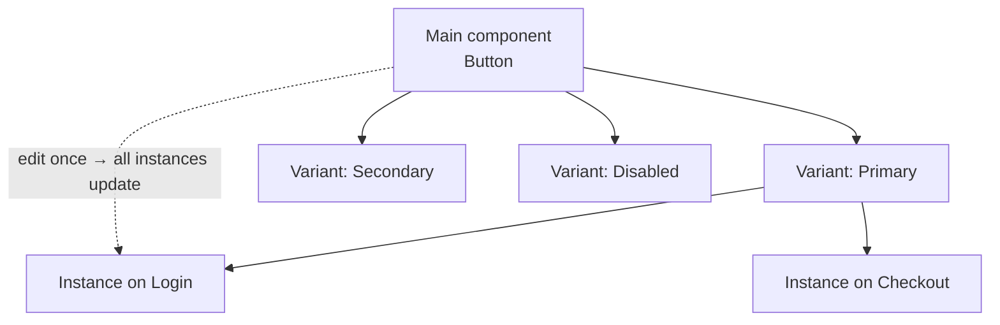

| Property | Options |
|---|---|
| Type | Primary / Secondary / Ghost |
| Size | Small / Medium / Large |
| State | Default / Hover / Disabled |

---

### 3.3 Design Tokens

Design tokens are named values for colors, spacing, type sizes, and corner radii (for example `color-primary`). Using tokens instead of raw values keeps designs and code consistent and makes rebranding easy.

**Sample:** one set of tokens used by design and code.

```json
{
  "color-primary": "#4F46E5",
  "color-text": "#1E293B",
  "space-md": "16px",
  "radius-md": "8px",
  "font-body": "16px"
}
```

```css
:root {
  --color-primary: #4F46E5;
  --space-md: 16px;
  --radius-md: 8px;
}
.btn { background: var(--color-primary); padding: var(--space-md); border-radius: var(--radius-md); }
```

> [!TIP]
> Change `--color-primary` once and every button, link, and badge updates: that is the power of tokens.

---

### 3.4 Building a Design System

A design system combines tokens, components, and usage guidelines in one shared source of truth. Start small with the elements you use most, and grow it as the product grows.

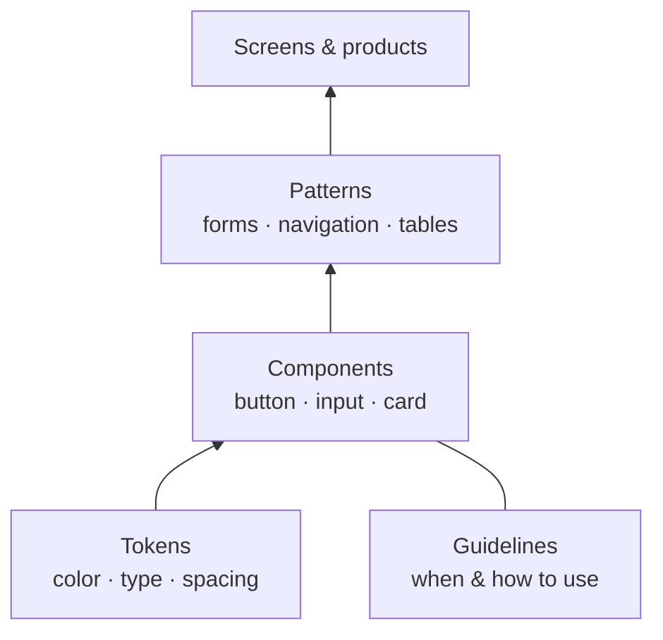

---

*Practice*

## Lesson 4 - Responsive And Adaptive Design

### 4.1 Breakpoints and Screen Sizes

Breakpoints are screen widths where the layout changes, such as phone, tablet, and desktop. Pick them based on where your content starts to look cramped or stretched rather than on specific devices.

| Name | Width range | Typical layout |
|---|---|---|
| Mobile | < 600 px | 1 column, stacked |
| Tablet | 600–1024 px | 2 columns |
| Desktop | > 1024 px | 3–4 columns, sidebar |

```
 ◄── 0 ───── 600 ───────── 1024 ──────────────►  width (px)
     Mobile  │   Tablet     │      Desktop
     ┌──┐    │  ┌──┬──┐     │   ┌──┬──┬──┬──┐
     │  │    │  │  │  │     │   │  │  │  │  │
     └──┘    │  └──┴──┘     │   └──┴──┴──┴──┘
```

---

### 4.2 Flexible Layouts

Flexible layouts use relative sizing, wrapping, and stacking so content adapts to the space available. Tools like auto layout in design software mirror how flexbox and grid work in code.

**Sample:** a wrapping row that adapts by itself.

```css
.cards {
  display: flex;
  flex-wrap: wrap;
  gap: 16px;
}
.cards > * { flex: 1 1 240px; }   /* grow, shrink, min ~240px wide */
```

| Design tool (auto layout) | CSS equivalent |
|---|---|
| Horizontal / vertical direction | `flex-direction` |
| Spacing between items | `gap` |
| Padding | `padding` |
| Hug / Fill / Fixed | `auto` / `flex: 1` / `width: 200px` |

---

### 4.3 Mobile-First Thinking

Designing for the smallest screen first forces you to prioritize what really matters. You then add space and secondary content as the screen gets larger.

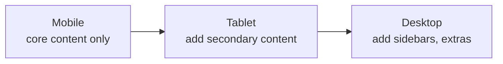

```css
.layout { display: block; }                    /* mobile default */
@media (min-width: 768px)  { .layout { display: grid; grid-template-columns: 1fr 1fr; } }
@media (min-width: 1200px) { .layout { grid-template-columns: 240px 1fr 300px; } }
```

---

### 4.4 Touch vs Pointer Interaction

Touch screens need larger targets (around 44 pixels or more) and no reliance on hover. Mouse users can use smaller targets and hover hints. Good designs work comfortably with both.

| | Touch | Pointer (mouse) |
|---|---|---|
| Min target size | 44 × 44 px | ~24 × 24 px |
| Hover tooltips | ❌ Not available | ✅ Fine |
| Gestures | Swipe, pinch, long-press | Click, right-click, scroll |

```
 ❌ Too small to tap          ✅ Comfortable tap target
   [x]                          ┌──────────┐
   (24px)                       │    ✕     │  44px
                                └──────────┘
```

---

*Practice*

## Lesson 5 - Prototyping And Testing

### 5.1 Linking Screens and Flows

Connect screens with clicks, taps, and transitions to simulate real navigation. Map the key user flows first, such as signing up or checking out, and prototype those before anything else.

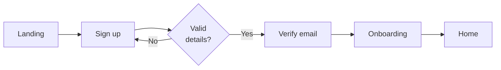

---

### 5.2 Micro-Interactions and Transitions

Small animations, such as a button press, a loading indicator, or a slide-in panel, give feedback and make an interface feel alive. Keep them quick and purposeful rather than decorative.

| Interaction | Duration | Easing |
|---|---|---|
| Button press | 100–150 ms | ease-out |
| Dropdown open | 150–200 ms | ease-out |
| Modal / panel slide | 250–300 ms | ease-in-out |
| Page transition | 300–400 ms | ease-in-out |

**Sample:** a hover micro-interaction.

```css
.btn { transition: transform .15s ease-out, box-shadow .15s ease-out; }
.btn:hover  { transform: translateY(-2px); box-shadow: 0 6px 16px rgba(0,0,0,.15); }
.btn:active { transform: translateY(0); }
```

---

### 5.3 Usability Testing

Watch real people try to complete tasks with your prototype and note where they hesitate or get lost. Even five participants will reveal most major problems.

**Sample test script:**

```text
Task 1: "You want to reset your password. Show me how you'd do it."
Task 2: "Find the invoice from last month."
Observe: Where do they hesitate? What do they say out loud? Do they succeed?
Rate: ✅ Success   ⚠ Success with difficulty   ❌ Failed
```

| Participants | Share of problems found (approx.) |
|---|---|
| 1 | ~31% |
| 3 | ~66% |
| 5 | ~85% |

---

### 5.4 Gathering and Applying Feedback

Collect feedback in one place, look for patterns rather than single opinions, and fix the issues that block key tasks first. Then test again to confirm the changes helped.

```
 Impact
 high │  Fix NEXT        │  Fix FIRST ⭐
      │  (nice to have)  │  (blocks key tasks)
      ├──────────────────┼──────────────────
 low  │  Ignore / later  │  Quick wins
      └──────────────────┴──────────────────
         low effort ◄────────► high effort
```

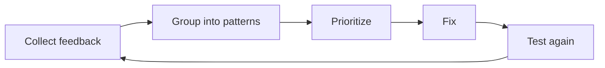

---

*Ecosystem*

## Lesson 6 - Collaboration And Handoff

### 6.1 Sharing and Commenting

Share a link to your design so teammates can view it and leave comments directly on the screens. Clear, specific comments tied to a location are much easier to act on than loose messages.

| ❌ Vague | ✅ Specific |
|---|---|
| "This feels off." | "The gap between the title and card is 32 px; our scale uses 16 px here." |
| "Fix the button." | "Primary button text fails contrast (2.6:1); try `#4338CA`." |

```
 Roles:  Viewer 👁 → Commenter 💬 → Editor ✏️ → Owner 👑
```

---

### 6.2 Developer Handoff and Specs

Handoff gives developers what they need: measurements, colors, fonts, spacing, and states. Using consistent components and tokens means fewer specs to explain and fewer surprises in the build.

**Sample spec card:**

| Property | Value |
|---|---|
| Component | Button / Primary |
| Size | 120 × 44 px |
| Padding | 12 px 24 px |
| Background | `color-primary` (`#4F46E5`) |
| Text | Inter Semibold 16 px, `#FFFFFF` |
| Radius | `radius-md` (8 px) |
| States | Default, Hover, Pressed, Disabled |

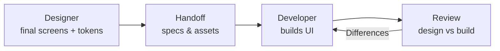

---

### 6.3 Exporting Assets

Export icons and illustrations as SVG when possible, and images at 1×, 2×, and 3× for different screen densities. Use clear file names so developers can find what they need.

```
 assets/
 ├── icons/
 │   ├── icon-search.svg
 │   └── icon-close.svg
 └── images/
     ├── hero.png        (1×)
     ├── hero@2x.png     (2×)
     └── hero@3x.png     (3×)
```

| Device density | Scale | 100 px element exports as |
|---|---|---|
| Standard | 1× | 100 px |
| Retina / most phones | 2× | 200 px |
| High-end phones | 3× | 300 px |

---

### 6.4 Versioning and File Organization

Keep files organized with named pages, tidy layers, and a clear separation between work in progress and approved designs. Version history lets you recover earlier states if a change goes wrong.

```
 📄 Project file
 ├── 📑 Cover
 ├── 📑 ✅ Ready for Dev
 │    ├── Login / Mobile
 │    └── Login / Desktop
 ├── 📑 🚧 Work in Progress
 ├── 📑 🧩 Components
 └── 📑 🗄 Archive
```

> [!TIP]
> Name versions meaningfully, e.g. **"v1.2 – approved checkout flow"**, so you can restore the right one later.

---

*Ecosystem*

## Lesson 7 - Choosing An Interface Tool

### 7.1 Matching Tools to Teams

Pick a tool your team can all use. Browser-based tools suit remote collaboration, while desktop-first tools may offer more offline power. Consider how well each one works with your developers' workflow.

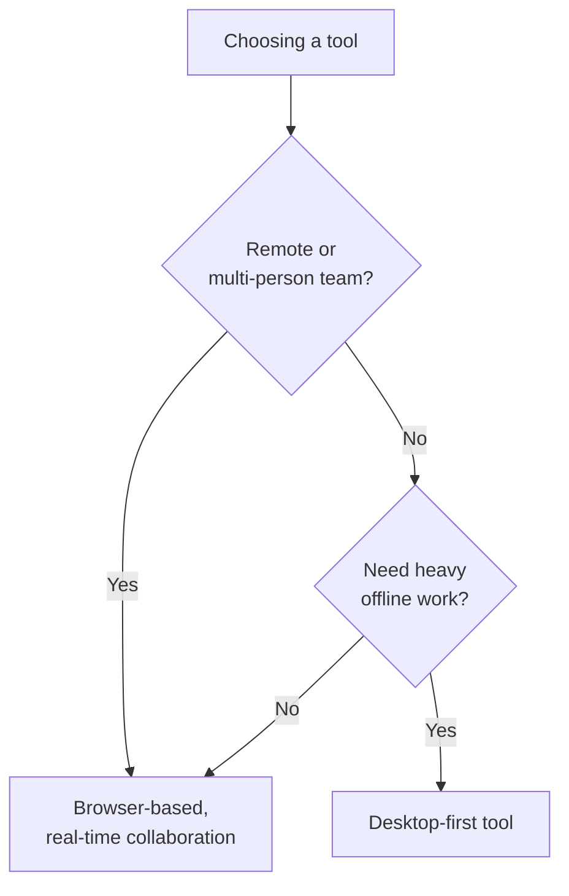

---

### 7.2 Free vs Paid Plans

Many design tools offer a free tier that is plenty for learning and small projects. Paid plans add team libraries, advanced permissions, and larger file or project limits.

| Feature | Free tier | Paid plan |
|---|---|---|
| Learning & personal projects | ✅ | ✅ |
| Limited number of files | ✅ | Unlimited |
| Shared team libraries | ❌ | ✅ |
| Advanced permissions | ❌ | ✅ |
| Version history | Limited | Extended |

---

### 7.3 Building a Portfolio

Show a few complete projects rather than many fragments. For each one, explain the problem, your process, the final design, and what you learned or measured.

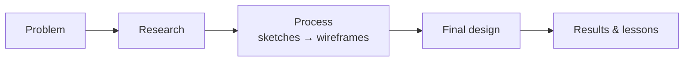

**Case study template:**

```markdown
# Project name — one-line summary
**Role:** UI/UX designer · **Time:** 4 weeks · **Tools:** Figma
## The problem
## Research & insights
## Process (sketches, wireframes, tests)
## Final design
## Results: what improved? What did I learn?
```

---

### 7.4 Where to Go Next

Open the Figma file in this topic and build a simple login screen with a reusable button. Then expand it into a small design system and a clickable prototype.

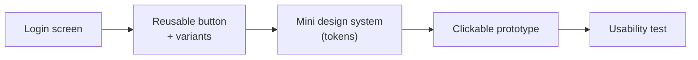