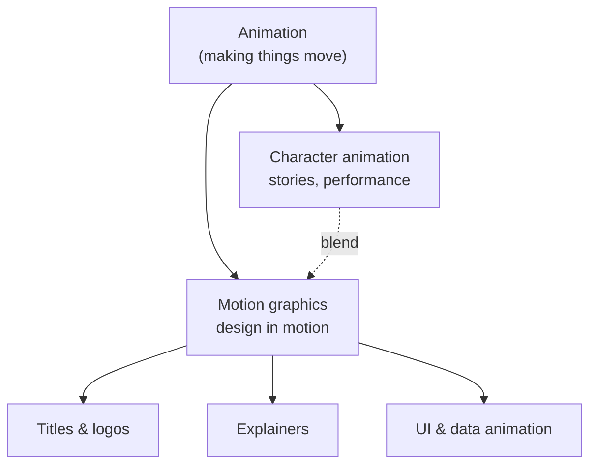
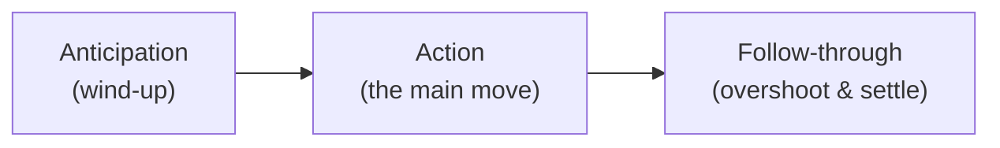
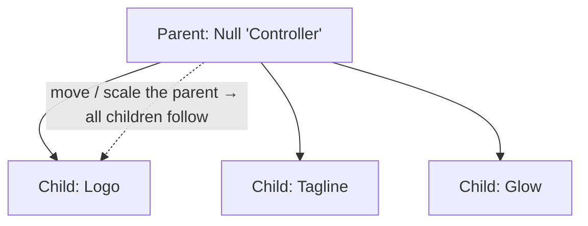
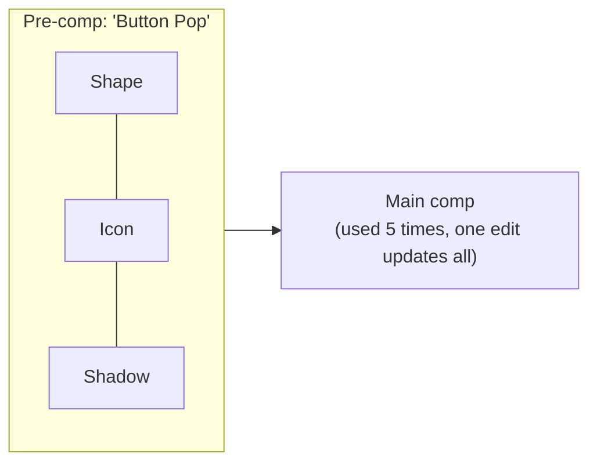
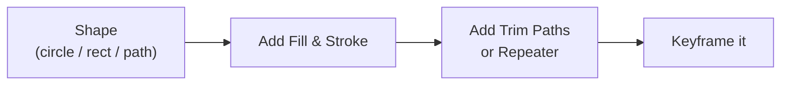
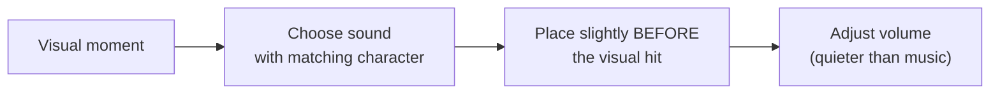
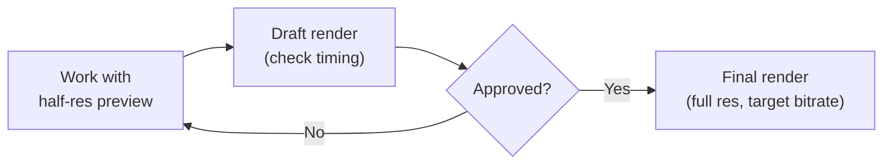
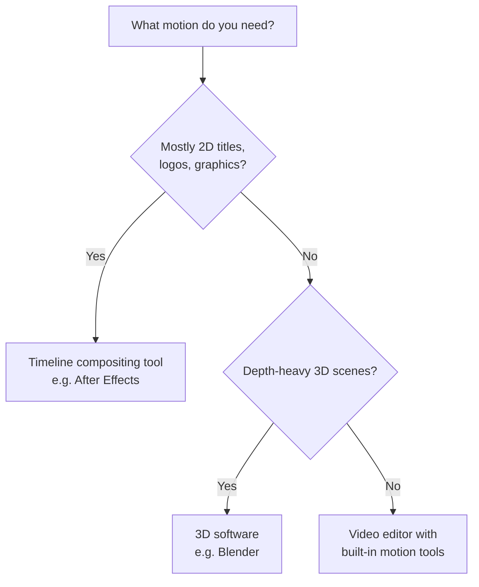
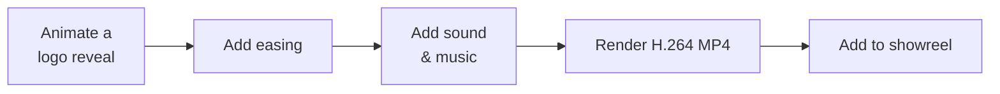

[⬅ Back to README](../../../README.md)

<div align="center">
  <br>
  <h1 style="margin-top: 0;">Introduction to Motion Graphics</h1>
</div>

Motion graphics is the art of animating shapes, text, and images to communicate ideas. It includes animated logos, title sequences, explainer videos, lower thirds, social media content, user-interface animations, and visual effects. This Topic covers the core concepts behind animation on a timeline: keyframes, easing, layers, compositions, and rendering, along with the principles that make motion feel natural and purposeful.

These lessons intentionally avoid tying the concepts to a single program. Once you understand the fundamentals here, head to the tool-specific file below to see how they are used in real software.

### Why Learn Motion Graphics?

- **Motion grabs attention** — animated content consistently outperforms static content on social media and in advertising.
- **It explains complex ideas simply** — animation can show processes and data in ways text and images cannot.
- **It combines many skills** — design, timing, storytelling, and sound all come together in a single project.
- **Concepts transfer between tools** — keyframes, easing curves, and compositions are common to nearly every animation program.

A quick sense of how motion graphics relates to nearby disciplines:

| Aspect | Motion Graphics | Traditional Animation | Video Editing |
|---|---|---|---|
| Main material | Shapes, text, graphics | Drawn or modeled characters | Recorded footage |
| Main goal | Communicate information or branding | Tell a character-driven story | Assemble and pace footage |
| Typical output | Titles, explainers, logos | Cartoons and films | Finished videos |
| Key skill | Timing and design | Drawing and performance | Storytelling and rhythm |

### Tools:

The lessons below teach the fundamentals that apply across motion graphics software. To see those fundamentals applied to a specific tool, continue on to:

<table align="center" width="100%" style="margin-left:auto;margin-right:auto;table-layout:fixed;"> <tr><th align="center" width="25%">Tool</th><th align="center" width="75%">Description</th></tr> <tr> <td align="center" width="25%" height="100"><a href="./AdobeAfterEffects.md"><br>Adobe After Effects</a></td> <td align="left" width="75%">Industry-standard tool for motion graphics, compositing, animation, and visual effects.</td> </tr> </table>

---

### Table of Contents

**Basics**

   1. **[What Is Motion Graphics](#lesson-1---what-is-motion-graphics)**  
       1.1 Defining Motion Graphics  
       1.2 Animation vs Motion Graphics  
       1.3 Frame Rate and Resolution  
       1.4 Common Use Cases  
   2. **[Principles Of Animation](#lesson-2---principles-of-animation)**  
       2.1 Timing and Spacing  
       2.2 Anticipation and Follow-Through  
       2.3 Squash and Stretch  
       2.4 Staging and Appeal  
   3. **[Animating On A Timeline](#lesson-3---animating-on-a-timeline)**  
       3.1 Keyframes  
       3.2 Easing and Graph Curves  
       3.3 Layers and Compositions  
       3.4 Parenting and Pre-Compositions  

**Practice**

   4. **[Text Shapes And Effects](#lesson-4---text-shapes-and-effects)**  
       4.1 Animating Text  
       4.2 Shape Layers and Paths  
       4.3 Masks and Mattes  
       4.4 Effects and Expressions  
   5. **[Adding Sound And Music](#lesson-5---adding-sound-and-music)**  
       5.1 Syncing Motion to Audio  
       5.2 Sound Effects  
       5.3 Music and Pacing  
       5.4 Audio Levels  

**Ecosystem**

   6. **[Rendering And Delivery](#lesson-6---rendering-and-delivery)**  
       6.1 Codecs and Containers  
       6.2 Rendering Settings  
       6.3 Exporting for Web and Social  
       6.4 Alpha Channels and Transparency  
   7. **[Choosing A Motion Graphics Tool](#lesson-7---choosing-a-motion-graphics-tool)**  
       7.1 Matching Tools to Tasks  
       7.2 Free vs Paid Software  
       7.3 Building a Showreel  
       7.4 Where to Go Next  

---

*Basics*

## Lesson 1 - What Is Motion Graphics

### 1.1 Defining Motion Graphics

Motion graphics are animated graphic elements, such as text, shapes, icons, and images, designed to communicate a message. Unlike a story-driven cartoon, the focus is usually on information, branding, or atmosphere.

```
 Static logo            Motion graphic (same logo, over time)
 ┌────────┐       t=0s        t=0.5s       t=1s        t=1.5s
 │   ◆    │      ┌──────┐     ┌──────┐    ┌──────┐    ┌──────┐
 │  ACME  │      │      │     │  ◇   │    │  ◆   │    │  ◆   │
 └────────┘      │      │     │      │    │ ACME │    │ ACME │
                 └──────┘     └──────┘    └──────┘    └──────┘
                 empty        shape pops   text slides  settles
```

---

### 1.2 Animation vs Motion Graphics

Animation is the broad craft of making things move, often with characters and stories. Motion graphics is a branch that focuses on graphic design in motion. The two share tools and principles, and many projects blend them.



---

### 1.3 Frame Rate and Resolution

Frame rate is how many images play per second: 24 fps feels cinematic, 30 fps is common for web and TV, and 60 fps is smooth for fast motion. Resolution is the pixel size of each frame, such as 1920 × 1080. Choose both to match where the video will be shown.

| Frame rate | Feel | Typical use |
|---|---|---|
| 24 fps | Cinematic | Film, trailers |
| 30 fps | Standard | Web, TV, social |
| 60 fps | Very smooth | Games, sports, fast UI motion |

| Resolution | Pixels | Name |
|---|---|---|
| 1280 × 720 | 0.9 MP | HD |
| 1920 × 1080 | 2.1 MP | Full HD |
| 3840 × 2160 | 8.3 MP | 4K UHD |

> [!TIP]
> **Frames needed = duration (seconds) × fps.** A 10-second clip at 30 fps is **300 frames**.

---

### 1.4 Common Use Cases

Typical uses include animated logos, title sequences, lower thirds, explainer videos, social media clips, data visualizations, and interface animations.

| Use case | Typical length | Goal |
|---|---|---|
| Logo sting | 3–5 s | Brand recognition |
| Title sequence | 30–90 s | Set tone |
| Lower third | 4–6 s | Label a speaker |
| Explainer | 60–120 s | Teach an idea |
| Social clip | 6–30 s | Grab attention fast |
| UI animation | 0.2–0.5 s | Feedback and delight |

---

*Basics*

## Lesson 2 - Principles Of Animation

### 2.1 Timing and Spacing

Timing is how long an action takes, and spacing is how the in-between positions are distributed. Fast actions feel energetic, and slow ones feel heavy or calm. Changing the spacing changes the feel without changing the duration.

```
 Same duration (1 s), different spacing

 Even (linear / robotic):   ●──●──●──●──●──●──●──●
 Ease-in (slow start):      ●●─●──●───●────●─────●
 Ease-out (slow finish):    ●─────●────●───●──●─●●
                            start ───────────► end
```

| Action | Frames at 24 fps | Feel |
|---|---|---|
| Quick blink | 3–4 | Snappy |
| Button pop | 6–8 | Energetic |
| Title slide-in | 12–18 | Smooth |
| Slow drift | 48+ | Calm |

---

### 2.2 Anticipation and Follow-Through

Anticipation is a small preparatory movement before the main action, like a wind-up before a throw. Follow-through is the settling after the action ends. Both make movement feel believable.

```
 Position over time (object moving right)

        anticipation   main action    follow-through
 pos ▲        ╲╲                     ╱‾‾╲   ╱‾‾
     │          ╲╲___            ___╱    ╲_╱   ← overshoot, then settle
     │              ╲╲_______╱‾‾
     └────────────────────────────────────────► time
       small pull-back first                
```



---

### 2.3 Squash and Stretch

Squashing and stretching an object as it moves gives it weight and flexibility. Even subtle use makes shapes feel alive, such as a ball compressing as it lands.

```
   falling          just before        impact         rebound
   (stretch)         impact            (squash)       (stretch)
      ⬮                ⬮                ⬬                ⬮
      │                │              ▁▁▁▁▁              │
   ───┴────────────────┴──────────────▔▔▔▔▔──────────────┴───
```

> [!NOTE]
> **Preserve volume:** when the shape gets taller, make it thinner; when it gets shorter, make it wider.

---

### 2.4 Staging and Appeal

Staging means presenting each moment so the viewer's eye goes where you want it, by simplifying the scene and avoiding competing motion. Appeal means making elements pleasing and easy to read.

```
 ❌ Cluttered: everything moves at once      ✅ Staged: one focus at a time
 ┌──────────────────────────┐              ┌──────────────────────────┐
 │ ↗  ↙  ↻   ↗   ↖  ↘       │              │                          │
 │ ↻  ↗  [TITLE]  ↙  ↻      │              │         [TITLE] ◄ moves  │
 │ ↙  ↖  ↗   ↘  ↻  ↗        │              │   · · ·  (rest is still) │
 └──────────────────────────┘              └──────────────────────────┘
```

---

*Basics*

## Lesson 3 - Animating On A Timeline

### 3.1 Keyframes

A keyframe records a property's value, such as position, scale, or opacity, at a specific time. The software fills in the motion between keyframes, so you only define the important moments.

```
 Opacity   ◆ keyframe     ─ interpolated by the software
 100% │                          ◆━━━━━━━━◆
      │                    ╱
  50% │              ╱─────
      │        ╱
   0% │ ◆━━━━━
      └─┬────────┬────────┬────────┬────► time
       0s       0.5s      1s       2s
```

| Time | Position X | Scale | Opacity |
|---|---|---|---|
| 0:00 | -200 px | 80% | 0% |
| 0:12 | 0 px | 100% | 100% |
| 2:00 | 0 px | 100% | 100% |

---

### 3.2 Easing and Graph Curves

Easing changes the speed of motion so it accelerates and decelerates instead of moving at a constant rate. Graph curves let you shape that speed precisely. Linear motion usually looks mechanical.

```
 Value ▲
       │            ___________ Ease-out (fast → slow)
       │         __╱  ..........  Ease-in-out (S-curve)
       │       ╱  ╱ ╱
       │     ╱  ╱ ╱  ← Linear (constant speed, robotic)
       │   ╱  ╱ ╱
       │ ╱__╱_╱  Ease-in (slow → fast)
       └─────────────────────────► Time
```

| Easing | Best for |
|---|---|
| Ease-out | Things entering the screen (arrive and settle) |
| Ease-in | Things leaving the screen (accelerate away) |
| Ease-in-out | Moves from A to B on screen |
| Linear | Constant motion: spinners, scrolling credits |

**Sample:** the same easing ideas written as CSS.

```css
.enter { animation: slideIn .6s cubic-bezier(.16, 1, .3, 1) both; }   /* strong ease-out */
@keyframes slideIn { from { transform: translateX(-200px); opacity: 0; } to { transform: none; opacity: 1; } }
```

---

### 3.3 Layers and Compositions

A composition is a container with its own size, frame rate, and duration. Inside it, layers stack from back to front, and each layer's properties can be animated independently.

```
 Composition: "Logo Reveal"  1920×1080 · 30 fps · 0:05

 Layers (top = in front)         0s    1s    2s    3s    4s    5s
 ───────────────────────         ├─────┼─────┼─────┼─────┼─────┤
 ▣ Tagline text                         ░░░░░░░░░░░░░░░░░░░░░░░░
 ▣ Logo shape                     ▒▒▒▒▒▒▒▒▒▒▒▒▒▒▒▒▒▒▒▒▒▒▒▒▒▒▒▒▒
 ▣ Glow                              ░░░░░░░░░░░░░░░░
 ▣ Background gradient           ████████████████████████████████
```

---

### 3.4 Parenting and Pre-Compositions

Parenting links one layer to another so they move together. Pre-compositions nest a group of layers inside a single layer, which keeps complex timelines tidy and lets you reuse animations.





---

*Practice*

## Lesson 4 - Text Shapes And Effects

### 4.1 Animating Text

Text can be animated as a whole, by line, by word, or by character. Staggered reveals, slides, and fades are common techniques, and readability should always come first.

```
 By character, staggered by 2 frames

 t=0   │
 t=2   │ M
 t=4   │ Mo
 t=6   │ Mot
 t=8   │ Moti
 t=10  │ Motio
 t=12  │ Motion   ← each letter fades + slides up slightly
```

| Level | Effect on feel |
|---|---|
| Whole text | Simple, clean |
| By line | Reads like a story |
| By word | Punchy, rhythmic |
| By character | Playful, detailed |

> [!TIP]
> Hold finished text on screen for about **0.3 s per word** plus a second, so people can finish reading.

---

### 4.2 Shape Layers and Paths

Shape layers are vector graphics you can animate directly. Paths can be reshaped, trimmed to draw on over time, or repeated to build patterns and icons.

```
 Trim Path "draw-on"     start=0%, end 0% → 100%

 end=0%      end=30%       end=70%        end=100%
   ·        ╭──·          ╭────╮          ╭────╮
                           ·   ╲          │    │ ✓
                                  ╲___    ╰────╯
```



---

### 4.3 Masks and Mattes

Masks reveal or hide part of a layer using a shape. Mattes use one layer's brightness or transparency to cut out another, which is useful for text reveals and transitions.

```
 Text reveal with a mask that moves

 mask ▕█████░░░░░░░░▏ →  "MOTI"      mask ▕████████████▏ → "MOTION"
       (only this part visible)             (fully revealed)
```

| Type | Uses | Example |
|---|---|---|
| Mask | A shape on the same layer | Wipe-reveal a title |
| Alpha matte | Another layer's transparency | Video inside a logo shape |
| Luma matte | Another layer's brightness | Gradient wipes, texture cut-outs |

---

### 4.4 Effects and Expressions

Effects apply processing such as blur, glow, or color adjustments. Expressions are small scripts that drive properties automatically, for example making an object wobble or follow another layer.

| Effect | Purpose |
|---|---|
| Gaussian Blur | Soften or de-focus |
| Glow | Light bloom around bright areas |
| Drop Shadow | Depth and separation |
| Fill / Tint | Color changes |

**Samples:** common expressions (After Effects-style JavaScript).

```javascript
// Wiggle position: 2 times per second, up to 20 px
wiggle(2, 20)

// Loop keyframes forever
loopOut("cycle")

// Make this layer follow another layer's X position
thisComp.layer("Ball").transform.position[0]
```

---

*Practice*

## Lesson 5 - Adding Sound And Music

### 5.1 Syncing Motion to Audio

Line up key movements with beats, hits, or spoken words so the animation feels connected to the sound. Audio waveforms in the timeline help you find the exact frames.

```
 Waveform:  ▁▁▂▇█▅▂▁▁▁▂▇█▅▂▁▁▁▂▇█▅▂▁▁
                 ▲           ▲           ▲
 Keyframes:      ◆           ◆           ◆   ← land motion on each beat
 Motion:      pop in      pop in      pop in
```

> [!NOTE]
> Tempo math: at **120 BPM** one beat = 0.5 s = **15 frames at 30 fps**.

---

### 5.2 Sound Effects

Whooshes, clicks, and impacts reinforce motion and make it feel physical. Use them sparingly and match their timing and character to the action.

| Visual action | Matching sound |
|---|---|
| Element slides in | Soft whoosh |
| Button press | Click / tick |
| Logo lands | Low impact / thud |
| Shape pops | Pop / bubble |
| Text typing | Keyboard ticks |



---

### 5.3 Music and Pacing

Music sets the tempo and mood, and cuts and animations often follow its rhythm. Choose a track first when you can, and build the timing around it.

```
 Song structure   │ Intro │ Verse │ Build │ Drop/Chorus │ Outro │
 Animation        │ slow  │ steady│ faster│ big moves   │ calm  │
 Energy           │ ▂▂    │ ▄▄    │ ▆▆▆   │ █████       │ ▃▂    │
```

---

### 5.4 Audio Levels

Keep dialogue or narration clear and lower music beneath it. Avoid peaking at the maximum level, which causes distortion, and check the mix on both speakers and headphones.

| Element | Typical peak level |
|---|---|
| Narration / dialogue | -12 to -6 dB |
| Music (under speech) | -24 to -18 dB |
| Music (no speech) | -14 to -8 dB |
| Sound effects | -18 to -10 dB |
| **Never exceed** | **0 dB (clipping)** |

```
   0 dB ┤ ▓▓ CLIPPING ZONE ▓▓
  -6 dB ┤ ██ narration peaks ██
 -12 dB ┤
 -18 dB ┤ ░░ music under speech ░░
 -24 dB ┤
```

---

*Ecosystem*

## Lesson 6 - Rendering And Delivery

### 6.1 Codecs and Containers

A codec compresses video (for example H.264 or ProRes), and a container holds the video, audio, and metadata (for example MP4 or MOV). Pick them based on whether you need small files or maximum quality.

```
 ┌──────────── Container: .mp4 ────────────┐
 │  🎞 Video stream  (codec: H.264)        │
 │  🔊 Audio stream  (codec: AAC)          │
 │  🏷 Metadata       (title, duration…)    │
 └─────────────────────────────────────────┘
```

| Codec | Container | Size | Quality | Use |
|---|---|---|---|---|
| H.264 | MP4 | Small | Good | Web, social |
| H.265 (HEVC) | MP4 / MOV | Smaller | Good+ | 4K delivery |
| ProRes 422 | MOV | Large | Excellent | Editing, masters |
| ProRes 4444 | MOV | Very large | Excellent + alpha | Transparent overlays |

---

### 6.2 Rendering Settings

Choose resolution, frame rate, and bitrate to match the destination. Preview at lower quality while working, then render at full quality only when the animation is finished.



| Setting | Draft | Final |
|---|---|---|
| Resolution | 50% (960 × 540) | 100% (1920 × 1080) |
| Bitrate (1080p H.264) | 3–5 Mbps | 10–16 Mbps |
| Frame rate | Match project | Match project |

---

### 6.3 Exporting for Web and Social

H.264 MP4 is the safest format for web and social platforms. Match each platform's recommended aspect ratio, such as 16:9 for YouTube and 9:16 for vertical video.

| Platform | Aspect ratio | Resolution |
|---|---|---|
| YouTube | 16:9 | 1920 × 1080 or 3840 × 2160 |
| Instagram Reels / TikTok / Shorts | 9:16 | 1080 × 1920 |
| Instagram feed | 1:1 or 4:5 | 1080 × 1080 / 1080 × 1350 |
| LinkedIn / X | 16:9 or 1:1 | 1920 × 1080 / 1080 × 1080 |

```
 16:9 ▭▭▭▭▭▭▭▭   9:16 ▯   1:1 ▢   4:5 ▯
 wide             tall     square  portrait-ish
```

> [!NOTE]
> Platform specs change over time, so double-check the latest recommendations before exporting.

---

### 6.4 Alpha Channels and Transparency

An alpha channel stores transparency so your animation can be placed over other footage. Export with a format that supports alpha, such as ProRes 4444 or WebM, when you need a transparent background.

```
 RGB only (opaque)       RGB + Alpha (transparent bg)     Over footage
 ┌────────────┐          ┌────────────┐                  ┌────────────┐
 │▓▓▓▓▓▓▓▓▓▓▓▓│          │ ░░░  ◆  ░░ │                  │🏔  ◆  🏔   │
 │▓▓▓  ◆  ▓▓▓▓│          │ ░░ ACME ░░ │                  │🏔 ACME 🏔  │
 └────────────┘          └────────────┘                  └────────────┘
 black box around logo   checkerboard = transparent      logo sits cleanly
```

| Format | Alpha | Notes |
|---|---|---|
| MP4 (H.264) | ❌ | Most compatible, no transparency |
| MOV (ProRes 4444) | ✅ | Pro workflows, large files |
| WebM (VP9) | ✅ | Web overlays |
| PNG sequence | ✅ | Universal, very large |

---

*Ecosystem*

## Lesson 7 - Choosing A Motion Graphics Tool

### 7.1 Matching Tools to Tasks

Timeline-based tools suit titles, logos, and effects, while 3D tools suit depth-heavy scenes. Choose the tool that fits the kind of motion you want, and note that many projects combine several.



---

### 7.2 Free vs Paid Software

Industry-standard tools are usually subscription-based, while free alternatives exist for learning, and some video editors include basic motion tools. The core concepts transfer across all of them.

| Tool type | Cost model | Good for |
|---|---|---|
| Industry-standard compositor | Subscription | Professional motion work |
| Free / open-source options | Free | Learning, simple projects |
| Video editor built-in tools | Included | Quick titles and transitions |

---

### 7.3 Building a Showreel

A showreel is a short video of your best work, ideally under a minute. Lead with your strongest piece, keep every clip purposeful, and add your contact details at the end.

```
 Showreel timeline (≈ 60 s)
 0s ├───────┬──────────┬──────────┬──────────┬──────┤ 60s
    │ Best  │ Piece 2  │ Piece 3  │ Piece 4  │ Name │
    │ work  │          │          │          │ +    │
    │ first!│          │          │          │ info │
```

| ✅ Do | ❌ Don't |
|---|---|
| Lead with your strongest piece | Bury your best work at the end |
| Cut to the beat of the music | Use long, unedited clips |
| Credit your specific role | Include weak or unfinished work |
| End with contact details | Go beyond ~60–90 seconds |

---

### 7.4 Where to Go Next

Open the After Effects file in this topic and animate a simple logo reveal. Then add easing, sound, and a final render to practice the full workflow.

