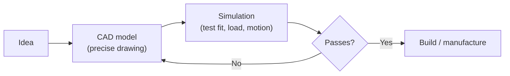
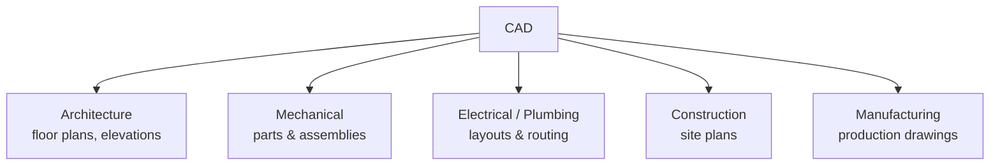
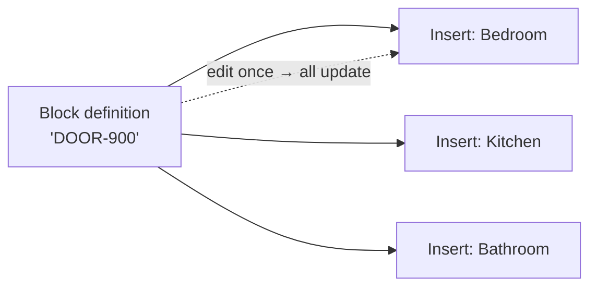
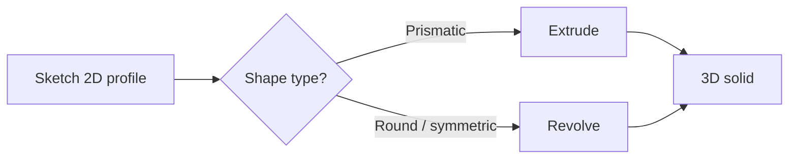
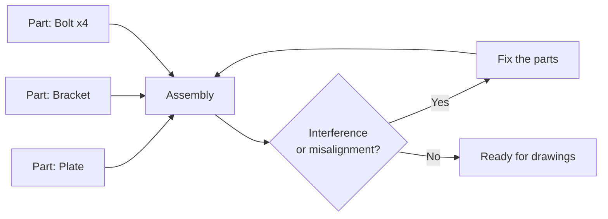
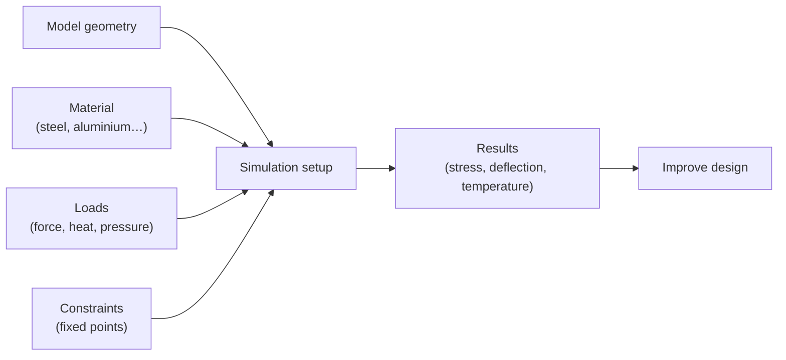
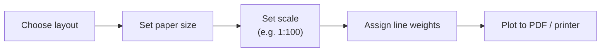
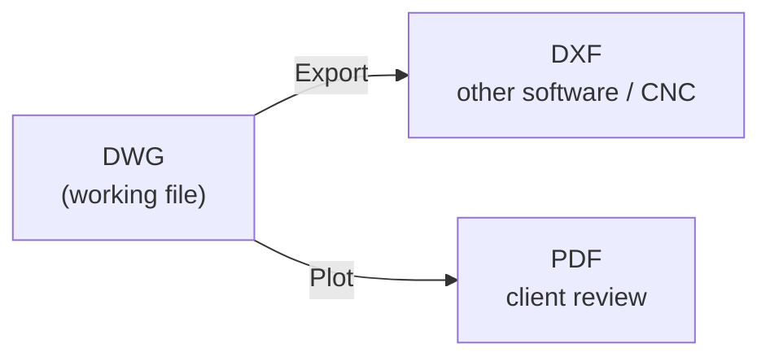
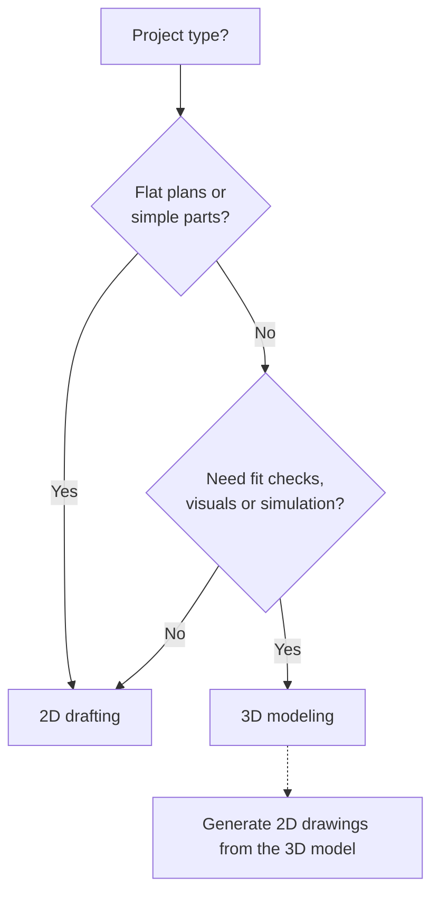
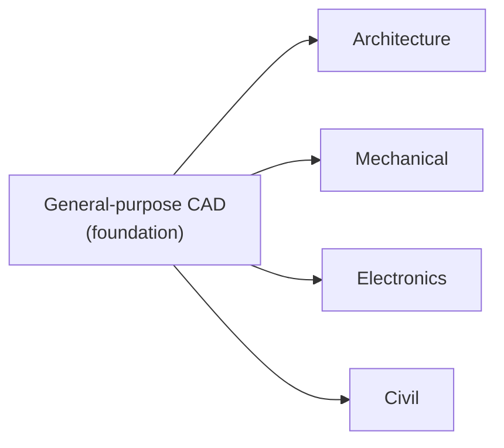

[⬅ Back to README](../../../README.md)

<div align="center">
  <br>
  <h1 style="margin-top: 0;">Introduction to Simulations</h1>
</div>

Simulation and technical design tools let you model real-world objects and systems precisely before building them. Engineers, architects, and designers use them to draft accurate plans, test dimensions and tolerances, and catch problems early, when they are still cheap to fix. This Topic covers the fundamentals of computer-aided design (CAD): how precise drawings are created, how 2D plans become 3D models, and how finished designs are documented and shared.

These lessons intentionally avoid tying the concepts to a single program. Once you understand the fundamentals here, head to the tool-specific file below to see how they are applied in practice.

### Why Learn Simulation And CAD?

- **Precision matters in the real world** — a drawing that is off by a few millimeters can mean a part that does not fit.
- **It lets you test before you build** — digital models are far cheaper to change than physical prototypes.
- **It's used across industries** — architecture, mechanical engineering, manufacturing, construction, and product design all rely on CAD.
- **It builds spatial reasoning** — you learn to think in dimensions, tolerances, and constraints.

A quick sense of how CAD differs from the illustration and 3D art tools you may already know:

| Aspect | CAD / Technical Design | Illustration | 3D Art |
|---|---|---|---|
| Main goal | Accurate, buildable designs | Visual appeal | Visual realism |
| Precision | Exact coordinates and dimensions | Approximate by eye | Approximate by eye |
| Typical output | Drawings, plans, manufacturing files | Images and graphics | Renders and animations |
| Measurement | Real-world units and tolerances | Pixels or points | Scene units |
| Common users | Engineers, architects, drafters | Designers, artists | Game and film artists |

### Tools:

The lessons below teach the fundamentals that apply across CAD and technical design software. To see those fundamentals applied to a specific tool, continue on to:

<table align="center" width="100%" style="margin-left:auto;margin-right:auto;table-layout:fixed;"> <tr><th align="center" width="25%">Tool</th><th align="center" width="75%">Description</th></tr> <tr> <td align="center" width="25%" height="100"><a href="./AutoCAD.md"><br>AutoCAD</a></td> <td align="left" width="75%">Professional CAD software for precise 2D drafting and 3D design, widely used in architecture and engineering.</td> </tr> </table>

---

### Table of Contents

**Basics**

   1. **[What Is Computer-Aided Design](#lesson-1---what-is-computer-aided-design)**  
       1.1 Defining CAD and Simulation  
       1.2 CAD vs Illustration  
       1.3 Units, Scale, and Precision  
       1.4 Industries and Use Cases  
   2. **[Coordinate Systems And Geometry](#lesson-2---coordinate-systems-and-geometry)**  
       2.1 Cartesian Coordinates  
       2.2 Absolute vs Relative Input  
       2.3 Points, Lines, and Curves  
       2.4 Snaps and Constraints  
   3. **[Drafting Fundamentals](#lesson-3---drafting-fundamentals)**  
       3.1 Drawing and Editing Objects  
       3.2 Layers and Organization  
       3.3 Dimensions and Annotations  
       3.4 Blocks and Reusable Symbols  

**Practice**

   4. **[From 2D Drawings To 3D Models](#lesson-4---from-2d-drawings-to-3d-models)**  
       4.1 Extruding and Revolving  
       4.2 Solids and Surfaces  
       4.3 Views and Projections  
       4.4 Assemblies and Parts  
   5. **[Testing And Reviewing Designs](#lesson-5---testing-and-reviewing-designs)**  
       5.1 Checking Fit and Tolerances  
       5.2 Measuring and Inspecting  
       5.3 Basic Simulation Concepts  
       5.4 Revising and Version Control  

**Ecosystem**

   6. **[Output And Collaboration](#lesson-6---output-and-collaboration)**  
       6.1 Printing and Plotting  
       6.2 Common File Formats (DWG, DXF, PDF)  
       6.3 Sharing With Teams and Clients  
       6.4 Standards and Conventions  
   7. **[Choosing A CAD Tool](#lesson-7---choosing-a-cad-tool)**  
       7.1 2D Drafting vs 3D Modeling  
       7.2 Free vs Paid Software  
       7.3 Industry-Specific Tools  
       7.4 Where to Go Next  

---

*Basics*

## Lesson 1 - What Is Computer-Aided Design

### 1.1 Defining CAD and Simulation

Computer-aided design (CAD) is the use of software to create precise drawings and models of real objects. Simulation extends this by testing how a design would behave, such as how it fits together, bears loads, or moves, before anything is built.



| Cost to fix a mistake | When found |
|---|---|
| $ | In the CAD model |
| $$ | During simulation / review |
| $$$$ | After building the prototype |
| $$$$$$ | After production or construction |

---

### 1.2 CAD vs Illustration

An illustration only needs to look right, while a CAD drawing must be exactly right. Every line in CAD has real coordinates and lengths, so the file can be used directly for planning and manufacturing.

```
 Illustration (looks about right)      CAD (exactly right)
      ┌──────────┐                       ┌──────────────┐ 
     ╱           │  "roughly a            │              │ 120.00 mm
    └────────────┘   rectangle"          │              │
                                         └──────────────┘
                                              80.00 mm
                                    Line from (0,0) to (80,0), exact
```

---

### 1.3 Units, Scale, and Precision

Set your drawing units (millimeters, meters, inches, feet) before you start. Draw objects at real-world size (1:1) and apply scale only when printing. Mixing units is a classic source of costly errors.

| Unit | Typical field |
|---|---|
| Millimeters (mm) | Mechanical parts, manufacturing |
| Meters (m) / Centimeters (cm) | Architecture, civil engineering |
| Inches / Feet | US construction and machining |

| Print scale | Meaning | Example |
|---|---|---|
| 1:1 | Full size | Small part |
| 1:10 | 1 unit on paper = 10 in reality | Furniture |
| 1:100 | 1 unit on paper = 100 in reality | Floor plan |

> [!WARNING]
> **Unit mix-ups are expensive.** A part drawn in inches but read as millimeters is 25.4× too small.

> **Formula:** *Paper length = real length ÷ scale factor.* A 5 m wall at 1:100 prints as 50 mm.

---

### 1.4 Industries and Use Cases

CAD is used in architecture for floor plans, in mechanical engineering for parts, in electrical and plumbing for layouts, in construction for site plans, and in manufacturing for production drawings.



---

*Basics*

## Lesson 2 - Coordinate Systems And Geometry

### 2.1 Cartesian Coordinates

Every point is described by its position along the X and Y axes (and Z in 3D). The origin (0,0) is the reference point, and knowing where it sits helps you place objects accurately.

```
        Y
        ▲
      4 ┤        ● B (3, 4)
      3 ┤
      2 ┤
      1 ┤  ● A (1, 1)
      0 ┼────┬────┬────┬────► X
        0    1    2    3    4
      origin (0,0)
```

| Point | X | Y |
|---|---|---|
| Origin | 0 | 0 |
| A | 1 | 1 |
| B | 3 | 4 |

> **Distance A → B** = √((3−1)² + (4−1)²) = √13 ≈ **3.61 units**

---

### 2.2 Absolute vs Relative Input

Absolute input gives a point's position from the origin, such as `10,5`. Relative input gives a point's position from the last point, such as `@10,5`. Polar input uses a distance and an angle, such as `@10<45`.

```
 Draw a 10 × 5 rectangle starting at the origin:

 Command: LINE
 From point:  0,0        ← absolute  (from the origin)
 To point:    @10,0      ← relative  (10 right of last point)
 To point:    @0,5       ← relative  (5 up)
 To point:    @-10,0     ← relative  (10 left)
 To point:    C          ← close back to the start
```

| Input type | Syntax | Meaning |
|---|---|---|
| Absolute | `10,5` | X = 10, Y = 5 from origin |
| Relative | `@10,5` | 10 right, 5 up from last point |
| Polar | `@10<45` | 10 units long at 45° |

```
 Polar @10<45
              ╱ ● end
            ╱
          ╱ 45°
  start ●───────► 0° (east)
```

---

### 2.3 Points, Lines, and Curves

Drawings are built from points, straight lines, arcs, circles, and splines. Complex shapes are combinations of these simple pieces, and each one is defined by exact numbers.

| Element | Defined by |
|---|---|
| Point | X, Y (and Z) |
| Line | Start point + end point |
| Circle | Center + radius |
| Arc | Center, radius, start & end angle |
| Spline | A set of control / fit points |

```
 Slotted plate = lines + arcs
   ╭────────────────╮   ←  2 arcs (ends)
   │                │      + 2 lines (sides)
   ╰────────────────╯
```

---

### 2.4 Snaps and Constraints

Snaps lock the cursor to exact features like endpoints, midpoints, and centers. Constraints keep relationships fixed, such as keeping two lines parallel or a circle tangent to a line, even when other parts change.

| Snap | Symbol | Locks to |
|---|---|---|
| Endpoint | ▢ | End of a line or arc |
| Midpoint | △ | Middle of a line |
| Center | ○ | Center of circle/arc |
| Intersection | ✕ | Where two objects cross |
| Perpendicular | ⊥ | 90° to an object |
| Tangent | ◔ | Touching a curve smoothly |

```
 Constraints                          Result when one part changes
 ──────── (parallel) ∥ ────────       Both lines stay parallel
 ──────── (parallel) ∥ ────────       even if you rotate one.

   ╭───╮
 ──┤ ○ ├──  (tangent)                 Circle stays touching the line
 ────────────────────────             as it is moved.
```

---

*Basics*

## Lesson 3 - Drafting Fundamentals

### 3.1 Drawing and Editing Objects

Basic drawing commands create lines, rectangles, and circles. Editing commands such as move, copy, offset, trim, and extend reshape them. Most drafting is a rhythm of drawing a rough shape and then editing it precisely.

| Command | Shortcut* | What it does |
|---|---|---|
| LINE | `L` | Draw straight segments |
| CIRCLE | `C` | Draw a circle |
| MOVE | `M` | Relocate objects |
| COPY | `CO` | Duplicate objects |
| OFFSET | `O` | Parallel copy at a set distance |
| TRIM | `TR` | Cut objects at boundaries |
| EXTEND | `EX` | Lengthen to a boundary |

*Shortcuts shown are AutoCAD-style; other programs vary.*

```
 Offset + Trim to make a wall

 1) Draw a line     2) OFFSET 200       3) Close ends + TRIM
 ────────────────   ────────────────    ┌──────────────┐
                    ────────────────    └──────────────┘
                    ↕ 200 mm wall
```

---

### 3.2 Layers and Organization

Layers group objects by purpose, such as walls, dimensions, and notes. Each layer has its own color and linetype and can be hidden or locked, which keeps complex drawings readable.

| Layer name | Color | Linetype | Purpose |
|---|---|---|---|
| `A-WALL` | White | Continuous | Walls |
| `A-DOOR` | Green | Continuous | Doors |
| `A-DIMS` | Red | Continuous | Dimensions |
| `A-CENTER` | Yellow | Center | Center lines |
| `A-HIDDEN` | Blue | Dashed | Hidden edges |
| `A-TEXT` | Cyan | Continuous | Notes |

```
 Layer panel                                  Drawing
 💡 🔓 A-WALL   ██  Continuous               ┌────────┐
 💡 🔓 A-DOOR   ██  Continuous               │        │ ← walls + doors
 💡 🔒 A-DIMS   ██  Continuous               └─┬──────┘    + dimensions
 🚫 🔓 A-TEXT   ██  Continuous               (A-TEXT is hidden: no notes shown)
```

---

### 3.3 Dimensions and Annotations

Dimensions state measurements, and annotations add text, notes, and symbols. They are what let a builder or machinist understand the drawing without guessing.

```
         ┌──────── 3000 ────────┐
         ├──────────────────────┤
    ┬    │                      │
    │    │       ROOM 01        │
 2400    │       7.2 m²         │
    │    │                      │
    ┴    └──────────────────────┘
          ← note: all dims in mm
```

| Dimension type | Measures |
|---|---|
| Linear | Straight distance (horizontal/vertical) |
| Aligned | Distance along a slanted edge |
| Angular | Angle between lines |
| Radius / Diameter | Circle and arc sizes |

---

### 3.4 Blocks and Reusable Symbols

A block is a saved group of objects, such as a door, bolt, or window, that can be inserted many times. Editing the block definition updates every copy.



```
 Door block (900 wide)
 ──┐          ┌──
   │ ╲        │
   │   ╲ arc  │   ← swing arc + leaf + frame = one block
 ──┘     ╲____└──
```

---

*Practice*

## Lesson 4 - From 2D Drawings To 3D Models

### 4.1 Extruding and Revolving

Extruding pushes a 2D shape along a straight path to give it thickness. Revolving spins a shape around an axis to create round forms such as cylinders and bottles.

```
 EXTRUDE                              REVOLVE
 2D rectangle  ──height 20──►  box    2D profile  ──360° around axis──►  vase
 ┌────┐                    ┌────┐│         ┆ ╭╮                           ╭──╮
 └────┘                    └────┘┘         ┆ ││                          ╭╯  ╰╮
                                           ┆ ╰╯                          ╰────╯
                                         axis
```



| Operation | Input | Typical results |
|---|---|---|
| Extrude | Closed 2D profile + height | Walls, plates, brackets |
| Revolve | Profile + axis + angle | Shafts, bottles, wheels |

---

### 4.2 Solids and Surfaces

Solids have volume and behave like real objects, so you can measure mass and cut holes. Surfaces are thin skins that are useful for complex curved shapes.

| | Solid | Surface |
|---|---|---|
| Has volume | ✅ | ❌ (zero thickness) |
| Measure mass | ✅ | ❌ |
| Boolean cuts | ✅ | Limited |
| Best for | Machined parts, buildings | Car bodies, complex curves |

```
 Boolean operations on solids
   Union (A+B)      Subtract (A−B)    Intersect (A∩B)
   ⬭⬭  merged       ⬭ with a hole      only the overlap
```

---

### 4.3 Views and Projections

Standard views (top, front, side) and an isometric view show a 3D model from different angles. Drawing views generated from the model stay in sync when the design changes.

```
 Orthographic layout (third-angle)

          ┌───────────┐
          │   TOP     │
          └───────────┘
 ┌───────┐ ┌───────────┐ ┌───────┐
 │ LEFT  │ │  FRONT    │ │ RIGHT │
 └───────┘ └───────────┘ └───────┘

 Isometric:      ╱▔▔▔▔▔╲
                ╱  ╱▔▔▔╲╲
               ▕  ▕     ▏▏   3D look, edges true to length
                ╲  ╲___╱╱
```

| View | Shows |
|---|---|
| Top (plan) | Looking straight down |
| Front (elevation) | Looking at the front face |
| Side | Looking from left/right |
| Isometric | All three faces at once |

---

### 4.4 Assemblies and Parts

A part is a single component, and an assembly combines parts into a product. Assembling them reveals fit problems, such as a bolt that doesn't line up with its hole.

```
 Assembly: Bracket Kit
 ├── Part: Bracket (x1)
 ├── Part: Bolt M8 (x4)
 ├── Part: Washer (x4)
 └── Part: Plate (x1)
```



---

*Practice*

## Lesson 5 - Testing And Reviewing Designs

### 5.1 Checking Fit and Tolerances

Tolerance is the allowed variation in a measurement. Checking that parts fit within their tolerances prevents problems such as a shaft that is too large for its bearing.

```
 Shaft Ø 20.00 mm  ±0.02        Hole Ø 20.05 mm  ±0.02

 Shaft range: 19.98 – 20.02     Hole range: 20.03 – 20.07
 Smallest gap  = 20.03 − 20.02 = 0.01 mm  ✅ always fits
 Largest gap   = 20.07 − 19.98 = 0.09 mm  ✅ not too loose
```

| Fit type | Result | Example |
|---|---|---|
| Clearance | Always loose | Sliding door track |
| Transition | May be tight or loose | Locating pin |
| Interference | Always tight (press fit) | Bearing in housing |

---

### 5.2 Measuring and Inspecting

Use measuring tools to check distances, angles, areas, and volumes in the model. Regular checks while drafting catch mistakes long before they reach production.

| Measure | Example result |
|---|---|
| Distance | 3000 mm between walls |
| Angle | 90° at corner |
| Area | 7.2 m² room |
| Volume | 0.004 m³ part |
| Mass | 1.2 kg (from material density) |

> [!TIP]
> Inspect your own work: measure a few critical dimensions *after* editing to confirm nothing shifted.

---

### 5.3 Basic Simulation Concepts

Simulations apply conditions such as forces, heat, or motion to a model to predict how it behaves. Inputs include materials, loads, and constraints, and the results guide design improvements.



```
 Beam fixed at left, 500 N load at right
 ▌━━━━━━━━━━━━━━━━━━━━━━━━━━┓            Stress map:
 ▌                           ▼ 500 N     🟥 high near the fixed end
 fixed                                    🟨 medium
                                          🟩 low near the free end
```

| Input | Question it answers |
|---|---|
| Material | How strong / stiff / conductive? |
| Load | What pushes or heats the part? |
| Constraint | Where is it held in place? |

---

### 5.4 Revising and Version Control

Save numbered versions, record what changed, and keep older files so you can go back. Clear revision notes help teams know which drawing is current.

**Sample revision table (in the title block):**

| Rev | Date | Description | By |
|---|---|---|---|
| A | 2025-01-10 | Initial issue | JD |
| B | 2025-01-24 | Wall thickness 150 → 200 mm | JD |
| C | 2025-02-03 | Added door D3 | AL |

```
 floor-plan_RevA.dwg  →  floor-plan_RevB.dwg  →  floor-plan_RevC.dwg ✅ current
                                              (older revisions kept in /archive)
```

---

*Ecosystem*

## Lesson 6 - Output And Collaboration

### 6.1 Printing and Plotting

Plotting turns a drawing into a scaled printout or PDF. Set the paper size, scale, and line weights so the printed result matches the intended standard.

| Paper size | Dimensions (mm) |
|---|---|
| A4 | 210 × 297 |
| A3 | 297 × 420 |
| A1 | 594 × 841 |
| ARCH D (US) | 610 × 914 |



| Line type | Typical weight |
|---|---|
| Walls / outlines | 0.5 mm |
| Details | 0.25 mm |
| Dimensions / text | 0.18 mm |

---

### 6.2 Common File Formats (DWG, DXF, PDF)

DWG is a common native CAD format. DXF is a more open exchange format that many programs can read. PDF is used for sharing finished drawings that don't need editing.

| Format | Editable | Best for |
|---|---|---|
| DWG | ✅ Full | Working files |
| DXF | ✅ (some loss possible) | Exchange between different CAD programs, CNC, laser cutting |
| PDF | ❌ | Final review and sign-off |



---

### 6.3 Sharing With Teams and Clients

Share files in formats others can open, and include any referenced files or fonts. Use clear file names and a consistent folder structure so everyone finds the right version.

```
 ProjectX/
 ├── 01-Working/      ← editable DWG files
 ├── 02-XRefs/        ← referenced files (site, survey)
 ├── 03-Issued/
 │   ├── 2025-02-03_RevC/
 │   │   ├── FloorPlan_RevC.pdf
 │   │   └── FloorPlan_RevC.dwg
 └── 04-Archive/      ← superseded revisions
```

> [!TIP]
> Use your program's *package / eTransmit* feature to bundle a drawing with its fonts and references.

---

### 6.4 Standards and Conventions

Industries follow drawing standards for line types, symbols, text sizes, and title blocks. Following them makes your drawings understandable to anyone in the field.

```
 Title block (bottom-right of every sheet)
 ┌─────────────────────────────────────────────┐
 │ Project: House Extension      Scale: 1:100   │
 │ Drawing: Ground Floor Plan    Sheet: 02/10   │
 │ Drawn: JD   Checked: AL       Date: 03-02-25 │
 │ Rev: C                        Drawing No: A-102 │
 └─────────────────────────────────────────────┘
```

| Standard family | Region / field |
|---|---|
| ISO | International |
| ASME Y14 | US mechanical drafting |
| BS / EN | UK / Europe |
| AIA / NCS | US architecture layer naming |

---

*Ecosystem*

## Lesson 7 - Choosing A CAD Tool

### 7.1 2D Drafting vs 3D Modeling

2D drafting is fast and well suited to plans and simple parts. 3D modeling takes more effort but allows visualization, fit checking, and simulation. Many workflows use both.

| | 2D drafting | 3D modeling |
|---|---|---|
| Speed for simple plans | ⭐⭐⭐ | ⭐ |
| Visualization | ⭐ | ⭐⭐⭐ |
| Fit & clash checking | ⭐ | ⭐⭐⭐ |
| Simulation | ❌ | ✅ |
| Learning curve | Lower | Higher |



---

### 7.2 Free vs Paid Software

Professional CAD is usually paid, though trials, student licenses, and free or open-source options exist. Pick the tool that matches the file formats and standards your industry uses.

| Option | Cost | Good for |
|---|---|---|
| Professional suites | Paid (subscription) | Industry work, DWG compatibility |
| Student / educational licenses | Free or discounted | Learning |
| Free trials | Free (limited time) | Evaluating |
| Open-source / free CAD | Free | Hobby, learning, basic drafting |

---

### 7.3 Industry-Specific Tools

Architecture, mechanical design, electronics, and civil engineering each have specialized CAD tools with built-in libraries and checks. General-purpose CAD is a good foundation before specializing.

| Field | Specialization | Built-in help |
|---|---|---|
| Architecture | Building modeling (BIM) | Walls, doors, schedules |
| Mechanical | Parametric part modeling | Fasteners, gears, simulation |
| Electronics | PCB / schematic design | Component libraries, DRC |
| Civil | Roads, terrain, utilities | Survey & grading tools |



---

### 7.4 Where to Go Next

Open the AutoCAD file in this topic and draw a simple room plan with layers and dimensions. Then try extruding a 2D profile into a 3D solid.

