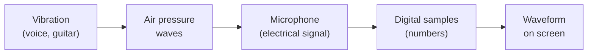
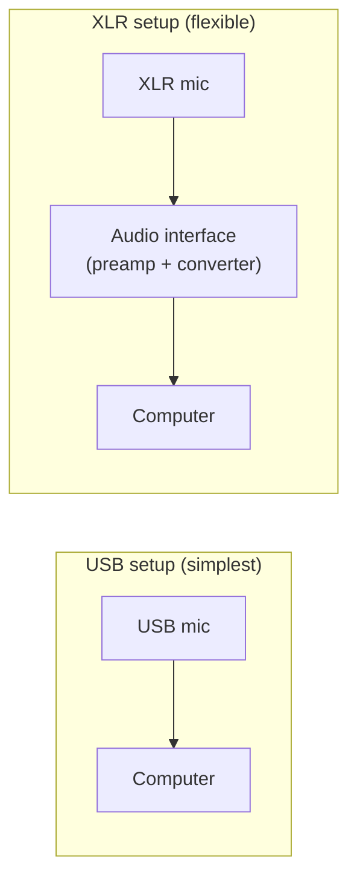
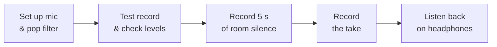
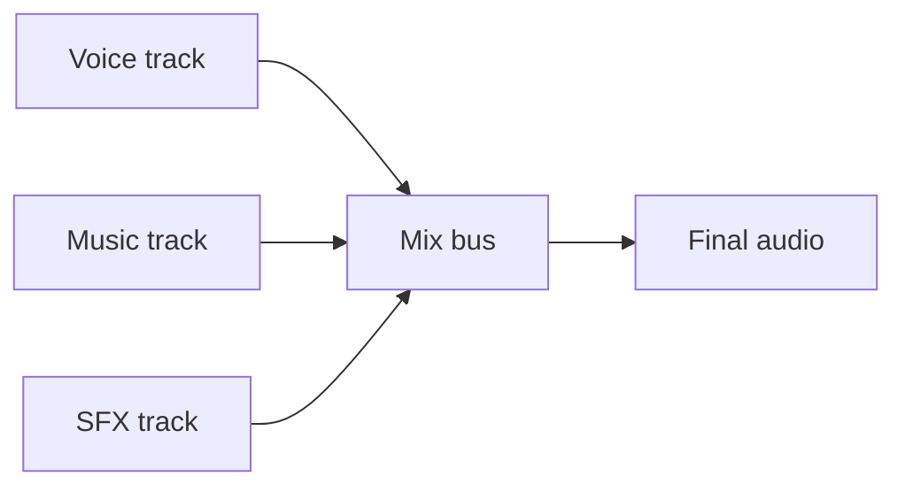
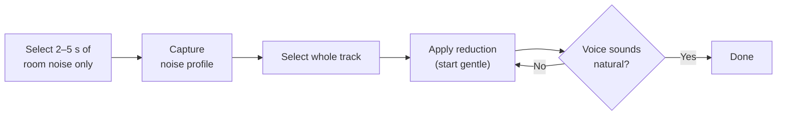
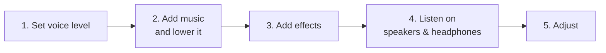
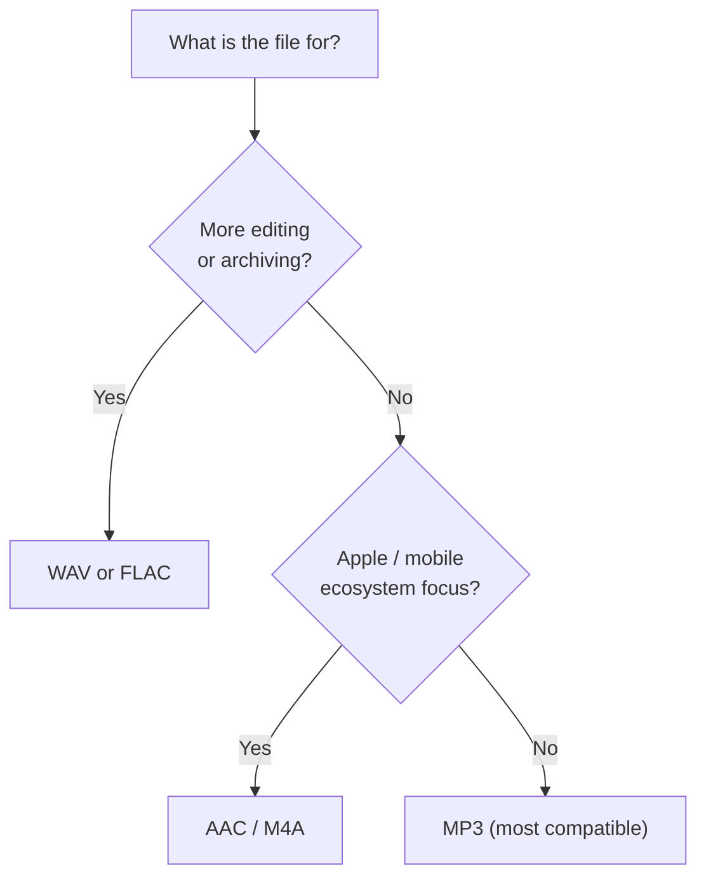
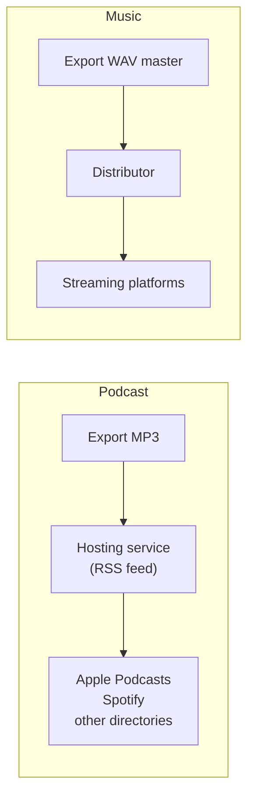
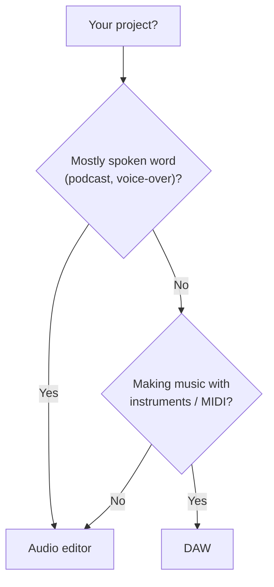
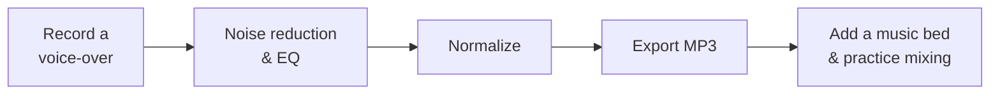

[⬅ Back to README](../../../README.md)

<div align="center">
  <br>
  <h1 style="margin-top: 0;">Introduction to Sound Production</h1>
</div>

Sound production is the process of recording, editing, and shaping audio, whether it's a podcast, a voice-over, music, or sound effects for a video or game. This Topic covers the fundamentals of digital audio: how sound is captured and stored, how waveforms are edited, how noise and levels are controlled, and how a final mix is prepared and exported.

These lessons intentionally avoid tying the concepts to a single program. Once you understand the fundamentals here, head to the tool-specific file below to see how they are applied in real software.

### Why Learn Sound Production?

- **Audio quality shapes how content is perceived** — viewers forgive average video far more readily than bad sound.
- **It's useful in many fields** — podcasting, video, games, music, and presentations all depend on good audio.
- **You can start with almost no equipment** — a basic microphone and free software are enough to learn the essentials.
- **The skills transfer** — waveforms, levels, EQ, and compression work the same way in every audio program.

A quick sense of the most common audio formats you will meet:

| Format | Type | Typical Use |
|---|---|---|
| WAV | Uncompressed | Recording and editing masters |
| FLAC | Lossless compressed | Archiving high-quality audio |
| MP3 | Lossy compressed | Podcasts and music sharing |
| AAC / M4A | Lossy compressed | Streaming and mobile devices |
| OGG | Lossy compressed | Open-source and web use |

### Tools:

The lessons below teach the fundamentals that apply across audio software. To see those fundamentals applied to a specific tool, continue on to:

<table align="center" width="100%" style="margin-left:auto;margin-right:auto;table-layout:fixed;"> <tr><th align="center" width="25%">Tool</th><th align="center" width="75%">Description</th></tr> <tr> <td align="center" width="25%" height="100"><a href="./Audacity.md"><br>Audacity</a></td> <td align="left" width="75%">Free, open-source audio recorder and editor for podcasts, voice-overs, and simple music projects.</td> </tr> </table>

---

### Table of Contents

**Basics**

   1. **[What Is Digital Audio](#lesson-1---what-is-digital-audio)**  
       1.1 Sound Waves and Waveforms  
       1.2 Sample Rate and Bit Depth  
       1.3 Mono vs Stereo  
       1.4 Common Audio Formats  
   2. **[Recording Audio](#lesson-2---recording-audio)**  
       2.1 Microphones and Audio Interfaces  
       2.2 Input Levels and Clipping  
       2.3 Room and Noise Considerations  
       2.4 Recording Best Practices  
   3. **[Editing Audio](#lesson-3---editing-audio)**  
       3.1 Selecting, Cutting, and Trimming  
       3.2 Fades and Crossfades  
       3.3 Multi-Track Editing  
       3.4 Non-Destructive Workflows  

**Practice**

   4. **[Cleaning And Enhancing Sound](#lesson-4---cleaning-and-enhancing-sound)**  
       4.1 Noise Reduction  
       4.2 Equalization (EQ)  
       4.3 Compression and Dynamics  
       4.4 Reverb and Effects  
   5. **[Mixing And Mastering](#lesson-5---mixing-and-mastering)**  
       5.1 Balancing Levels  
       5.2 Panning and Stereo Image  
       5.3 Loudness and Normalization  
       5.4 Mastering Basics  

**Ecosystem**

   6. **[Exporting And Delivery](#lesson-6---exporting-and-delivery)**  
       6.1 Choosing an Export Format  
       6.2 Bitrate and Quality Settings  
       6.3 Metadata and Tagging  
       6.4 Publishing Podcasts and Music  
   7. **[Choosing A Sound Tool](#lesson-7---choosing-a-sound-tool)**  
       7.1 Editors vs Digital Audio Workstations  
       7.2 Free vs Paid Software  
       7.3 Building a Home Setup  
       7.4 Where to Go Next  

---

*Basics*

## Lesson 1 - What Is Digital Audio

### 1.1 Sound Waves and Waveforms

Sound is vibration traveling through the air. A waveform is a picture of that vibration over time: tall peaks mean loud moments, and flat sections mean silence. Editing audio means working with this picture.

```
 Amplitude
   +1 │      ╭╮        ╭─╮
      │    ╭╯ ╰╮     ╭╯  ╰╮
    0 ┼───╯     ╰───╯      ╰───────────  time →
      │          ╰╮ ╭╯
   -1 │           ╰─╯
      └───────────────────────────────
       quiet   LOUD   medium   silence
```



| Wave property | Hear it as |
|---|---|
| Amplitude (height) | Loudness |
| Frequency (cycles/sec, Hz) | Pitch |
| Shape | Tone / timbre |

---

### 1.2 Sample Rate and Bit Depth

Sample rate is how many times per second the sound is measured (44.1 kHz for music, 48 kHz for video). Bit depth is how finely each measurement is recorded (16-bit is standard, 24-bit gives more headroom for recording). Higher values capture more detail but make larger files.

```
 Low sample rate (8 kHz)         High sample rate (48 kHz)
   ●     ●     ●                  ●●●●●●●●●●●●●●●●●
  ╱ ╲   ╱ ╲   ╱ ╲                ╱ ╲╱╲╱╲╱╲╱╲╱╲╱╲╱╲╲
 coarse, jagged copy              smooth, accurate copy
```

| Bit depth | Possible levels | Dynamic range |
|---|---|---|
| 8-bit | 256 | ~48 dB (hissy) |
| 16-bit | 65,536 | ~96 dB (CD quality) |
| 24-bit | 16,777,216 | ~144 dB (recording) |

> [!TIP]
> **File size (uncompressed) = sample rate × bit depth × channels × seconds ÷ 8.** One minute of 44.1 kHz, 16-bit stereo ≈ **10.6 MB**.

| Sample rate | Typical use |
|---|---|
| 44.1 kHz | Music, podcasts |
| 48 kHz | Video, film |
| 96 kHz | High-resolution recording |

---

### 1.3 Mono vs Stereo

Mono has a single channel, which is ideal for a solo voice. Stereo has left and right channels, which creates width and is standard for music. Recording a single microphone in stereo just doubles the file size.

```
 MONO  (1 channel)             STEREO (2 channels)
  🔊 ← both speakers hear      L 🔊 ◄── left channel
     the same sound             R 🔊 ◄── right channel
                               (different signals → width)
```

| | Mono | Stereo |
|---|---|---|
| Channels | 1 | 2 |
| File size | 1× | 2× |
| Best for | Voice, podcasts, dialogue | Music, ambience, effects |

---

### 1.4 Common Audio Formats

WAV and FLAC keep full quality, while MP3 and AAC shrink files by discarding detail. Record and edit in an uncompressed format, and compress only when exporting the final file.

| Format | Approx. size for 1 min stereo | Quality |
|---|---|---|
| WAV (44.1 kHz/16-bit) | ~10.6 MB | Perfect |
| FLAC | ~5–6 MB | Perfect (lossless) |
| MP3 (128 kbps) | ~1 MB | Good |
| MP3 (320 kbps) | ~2.4 MB | Very good |


---

*Basics*

## Lesson 2 - Recording Audio

### 2.1 Microphones and Audio Interfaces

USB microphones plug straight into a computer and are the easiest way to start. XLR microphones connect through an audio interface and offer more flexibility and quality. Dynamic microphones tolerate noisy rooms, while condenser microphones capture more detail in quiet ones.



| | Dynamic | Condenser |
|---|---|---|
| Sensitivity | Lower | Higher |
| Handles noisy rooms | ✅ Better | ❌ Picks up everything |
| Needs phantom power (+48V) | No | Yes (XLR) |
| Best for | Untreated rooms, live | Quiet studios, detailed voice |

---

### 2.2 Input Levels and Clipping

Clipping is harsh distortion that happens when the signal is too loud for the recording to hold, and it can't be repaired afterward. Set your input level so the loudest peaks stay comfortably below the maximum, around -12 dB to -6 dB.

```
   0 dB ┤▔▔▔▔▔▔▔▔▔▔▔▔▔▔▔▔▔▔▔  maximum (digital ceiling)
        │   ✂ ✂ CLIPPED ✂ ✂      ← flat tops = distortion ❌
  -6 dB ┤   ╭──╮                  ┐
        │ ╭─╯  ╰─╮               │ ✅ target peaks: -12 to -6 dB
 -12 dB ┤╯        ╰╮              ┘
        │
 -60 dB ┤ ▁▁▁ noise floor
```

> [!WARNING]
> Clipping can't be fixed in editing. If in doubt, record **quieter**: you can always turn it up later.

---

### 2.3 Room and Noise Considerations

Hard, empty rooms create echo, and appliances, fans, and traffic add noise. Record in a small, soft space such as a room with curtains, rugs, and furniture, and turn off anything that hums.

| ❌ Poor space | ✅ Better space |
|---|---|
| Empty room, bare walls | Bedroom with bed, curtains, rugs |
| Kitchen (hard surfaces, fridge hum) | Closet full of clothes (great vocal booth!) |
| Next to a window or fan | Away from windows, devices off |

```
 Hard room: echoes bounce        Soft room: sound is absorbed
 ┃ ◄──►  ◄──► ┃                  ▒ ──►          ▒  curtains, rugs,
 ┃ 🎤  many reflections ┃          ▒ 🎤 dry, clean ▒  couches soak up
                                                     reflections
```

---

### 2.4 Recording Best Practices

Keep a consistent distance from the microphone, use a pop filter for voice, do a short test recording, and capture a few seconds of room silence for noise reduction later.



| Tip | Why |
|---|---|
| ~10–15 cm (a fist-width) from mic | Natural, close sound |
| Speak slightly off-axis | Reduces plosives ("p", "b") |
| Hydrate, stay consistent | Keeps tone steady |
| Leave a pause before and after | Easier editing |

---

*Basics*

## Lesson 3 - Editing Audio

### 3.1 Selecting, Cutting, and Trimming

Select a section of the waveform to delete, copy, or move it. Trim the silence from the start and end, and remove mistakes, coughs, and long pauses to tighten the pacing.

```
 Before:  ▁▁▁▁│▃▆█▆▃ um ▃▅▃│▁▁▁▁▁▁▁▁│▃▆█▆▃▅▃▂│▁▁▁
               good   [mistake]  long pause   good
 Select & delete the mistake and shorten the pause:
 After:   ▁▁│▃▆█▆▃▃▅▃│▁▁│▃▆█▆▃▅▃▂│▁▁
```

| Edit | Shortcut* | Use |
|---|---|---|
| Cut | `Ctrl/Cmd + X` | Remove and keep a clipboard copy |
| Delete | `Del` | Remove, close the gap or leave silence |
| Split | `Ctrl/Cmd + I` | Cut a clip into two |
| Silence | `Ctrl/Cmd + L` | Replace selection with silence |

*Shortcuts shown are Audacity-style; other editors vary.*

---

### 3.2 Fades and Crossfades

A fade gradually raises or lowers volume, which prevents abrupt starts and ends. A crossfade blends one clip into the next so edits don't produce clicks or sudden changes.

```
 Fade in                 Fade out              Crossfade
 volume                  volume                volume
   ▲    ╱▔▔▔▔             ▲▔▔▔▔╲                ▲ ╲   ╱
   │  ╱                   │      ╲               │  ╲ ╱   ← clip A fades out
   │╱                     │        ╲             │  ╱╲      clip B fades in
   └──────► time          └──────────► time      └─────────► time
```

> [!TIP]
> Even a **5–10 ms** fade at an edit point removes clicks and pops.

---

### 3.3 Multi-Track Editing

Multi-track editing places voice, music, and effects on separate tracks so each can be adjusted independently. It is the basis of podcasts, voice-overs, and mixes.

```
 Track 1  Voice   │ ▃▆█▆▃ │      │ ▃▆█▃ │     │ ▃▅█▆▃ │
 Track 2  Music   │▂▂▂▂▂▂▂▂▂▂▂▂▂▂▂▂▂▂▂▂▂▂▂▂▂▂▂▂▂▂▂▂▂▂▂▂│  (lowered)
 Track 3  SFX     │   ◆ whoosh        ◆ ding            │
                  0s     5s     10s     15s     20s
```



---

### 3.4 Non-Destructive Workflows

Keep the original recording untouched and work on copies, or use edits that can be undone. Save a project file in addition to exported audio so you can change things later.

```
 podcast-ep01/
 ├── 01-raw/        ← never edit these (originals)
 │   └── interview_raw.wav
 ├── 02-project/    ← project file (references audio, keeps edits)
 │   └── ep01.aup3
 └── 03-exports/
     └── ep01_final.mp3
```

---

*Practice*

## Lesson 4 - Cleaning And Enhancing Sound

### 4.1 Noise Reduction

Noise reduction learns the sound of steady background noise, such as hiss or hum, and lowers it. Use it gently, since too much makes voices sound thin or watery.



| Setting | Gentle (recommended) | Aggressive (risky) |
|---|---|---|
| Reduction | 6–12 dB | 24 dB+ |
| Result | Natural voice | Robotic / underwater artifacts |

---

### 4.2 Equalization (EQ)

EQ boosts or cuts specific frequency ranges. Cutting low rumble below about 80 Hz and gently boosting clarity in the upper midrange are common ways to improve a voice.

```
 Gain
 +3 dB│                       ╭──╮
  0 dB┼──────────────────────╯    ╰──────   ← gentle presence boost
 -3 dB│
 -∞   │▁▁╲                                  ← low cut (rumble)
      └──┬─────┬──────┬───────┬──────┬────► Hz
        80   250    1 k     3–5 k   10 k
```

| Range | Character | Typical voice tweak |
|---|---|---|
| < 80 Hz | Rumble | Cut (high-pass filter) |
| 100–250 Hz | Warmth / boom | Reduce if muddy |
| 1–3 kHz | Body | Leave mostly alone |
| 3–5 kHz | Clarity / presence | Gentle boost |
| 6–10 kHz | Sibilance ("s") | Tame if harsh |

---

### 4.3 Compression and Dynamics

A compressor reduces the gap between loud and quiet parts so the volume feels even. Moderate settings keep the voice steady without squashing its natural character.

```
 Before compression               After compression
 ▁▂█▂▁▁▃▇▃▁▁▂█▂                   ▃▅▆▅▃▃▅▆▅▃▃▅▆▅
 big differences                  more even, easier to hear
```

| Control | Meaning | Voice starting point |
|---|---|---|
| Threshold | Level where compression starts | -18 to -12 dB |
| Ratio | How strongly peaks are reduced | 2:1 to 4:1 |
| Attack | How fast it reacts | 10–30 ms |
| Release | How fast it lets go | 100–250 ms |
| Makeup gain | Volume added back | To taste |

> **Example:** Ratio 4:1 means for every 4 dB the signal goes *over* the threshold, only 1 dB comes out.

---

### 4.4 Reverb and Effects

Reverb adds a sense of space, while other effects such as delay and pitch change add color. Use them sparingly, since too much can bury clarity.

| Effect | What it does | Typical use |
|---|---|---|
| Reverb | Simulates a room | Sense of space |
| Delay / Echo | Repeats the sound | Musical or dramatic effect |
| Pitch shift | Raises / lowers pitch | Character voices |
| Chorus | Thickens a sound | Instruments, vocals |

```
 Dry:      ▇
 Reverb:   ▇ ▅ ▄ ▃ ▂ ▁   ← fading reflections
 Delay:    ▇     ▅     ▃     ▁   ← distinct repeats
```

> [!TIP]
> Voice-over: keep reverb **very subtle** (around 5–10% wet) unless you want a "big hall" sound.

---

*Practice*

## Lesson 5 - Mixing And Mastering

### 5.1 Balancing Levels

Set the main element, usually voice, first, then fit music and effects around it. Music under speech should sit noticeably lower so words stay easy to understand.

```
 Level (dB)
  -6 ┤ ███ voice
 -12 ┤
 -18 ┤ ▒▒▒ sound effects
 -24 ┤ ░░░ music under speech
     └────────────────────────
```



---

### 5.2 Panning and Stereo Image

Panning places sounds between the left and right speakers. Keep the main voice centered, and use panning on music and effects to create width and separation.

```
 L ◄━━━━━━━━━━━━━━━━ center ━━━━━━━━━━━━━━━━► R
     🎸 guitar L30   🎤 VOICE (C)   🎹 keys R30
        🥁 hi-hat L60                ✨ SFX R70
```

| Element | Typical pan |
|---|---|
| Voice / narration | Center |
| Bass, kick | Center |
| Rhythm guitar, keys | L / R 30–60% |
| Ambient sounds, effects | Wide |

---

### 5.3 Loudness and Normalization

Normalization raises the whole recording to a target level. Loudness standards, measured in LUFS, keep different shows and tracks at a similar perceived volume. Podcasts commonly target around -16 LUFS, though platforms vary.

| Content | Common target (approx.) |
|---|---|
| Podcast (stereo) | -16 LUFS |
| Podcast (mono) | -19 LUFS |
| Streaming music | -14 LUFS |
| Broadcast TV (EU) | -23 LUFS |

> [!NOTE]
> Targets differ per platform and change over time. Check the latest specs before delivering.

```
 Before normalization:  quiet episode  ▂▃▂▃▂   -26 LUFS
 After  normalization:  matching level ▅▆▅▆▅   -16 LUFS  (same sound, louder)
```

---

### 5.4 Mastering Basics

Mastering is the final polish: a gentle EQ, light compression, and a limiter to control peaks. The goal is a consistent, balanced result that sounds good on many playback devices.


> [!TIP]
> Test your master on **earbuds, laptop speakers, car, and a phone speaker**. If it works everywhere, it's solid.

---

*Ecosystem*

## Lesson 6 - Exporting And Delivery

### 6.1 Choosing an Export Format

Use WAV or FLAC for archives and further editing, and MP3 or AAC for sharing and publishing. Pick based on whether quality or file size matters more.



---

### 6.2 Bitrate and Quality Settings

Bitrate controls how much data each second of audio gets. For spoken word, 96 to 128 kbps MP3 is often enough, and music generally sounds best at 192 kbps or higher.

| Content | Suggested MP3 bitrate |
|---|---|
| Voice (mono) | 64–96 kbps |
| Voice (stereo) | 96–128 kbps |
| Music (good) | 192 kbps |
| Music (high quality) | 256–320 kbps |

> **Quick math:** size (MB) ≈ bitrate (kbps) × seconds ÷ 8000. A 30-minute podcast at 128 kbps ≈ **28.8 MB**.

---

### 6.3 Metadata and Tagging

Metadata such as title, artist, album, and cover art is stored inside the file. Filling it in properly helps players and podcast apps display your work correctly.

**Sample tags:**

```yaml
Title:  "Episode 12 – Mixing Basics"
Artist: "Sound School Podcast"
Album:  "Season 1"
Track:  12
Year:   2025
Genre:  "Podcast"
Cover:  cover-3000x3000.jpg   # square, high-resolution
```

---

### 6.4 Publishing Podcasts and Music

Podcasts are published through a hosting service that provides an RSS feed, which directories read. Music is usually delivered through a distributor to streaming platforms. Check each platform's format and loudness requirements first.



**Sample (simplified) RSS item:**

```xml
<item>
  <title>Episode 12 – Mixing Basics</title>
  <enclosure url="https://example.com/ep12.mp3" length="28800000" type="audio/mpeg"/>
  <pubDate>Mon, 03 Feb 2025 08:00:00 GMT</pubDate>
</item>
```

---

*Ecosystem*

## Lesson 7 - Choosing A Sound Tool

### 7.1 Editors vs Digital Audio Workstations

Audio editors focus on recording, cleaning, and exporting, which suits podcasts and voice-overs. Digital audio workstations (DAWs) add virtual instruments, MIDI, and advanced mixing for music production.

| | Audio editor | DAW |
|---|---|---|
| Record & clean voice | ✅ Excellent | ✅ |
| Virtual instruments / MIDI | ❌ | ✅ |
| Complex music mixing | Limited | ✅ |
| Learning curve | Gentle | Steeper |
| Best for | Podcasts, voice-overs | Songs, scoring, beats |



---

### 7.2 Free vs Paid Software

Free editors handle most spoken-word work well. Paid DAWs add larger sound libraries, plugins, and workflow features that matter more for music production.

| Category | Cost | Good for |
|---|---|---|
| Free editors (e.g. Audacity) | Free | Podcasts, voice-overs, learning |
| Entry DAWs | Low / one-time | Home music production |
| Pro DAWs | Paid | Studio workflows, large sessions |

---

### 7.3 Building a Home Setup

A decent microphone, closed-back headphones, a pop filter, and a quiet, soft-furnished space are enough to produce clear audio. Upgrade gradually as your needs grow.

```
        🎤 mic ── pop filter
         │
 💻 computer ◄── USB / interface
         │
 🎧 closed-back headphones  (for monitoring, no sound leaking into the mic)
 🛋 soft furnishings around you
```

| Priority | Item | Why |
|---|---|---|
| 1 | Quiet, soft room | Biggest quality gain, free |
| 2 | Decent microphone | Clean capture |
| 3 | Closed-back headphones | Accurate monitoring |
| 4 | Pop filter & stand | Less plosives, steady distance |
| 5 | Audio interface (XLR path) | More flexibility later |

---

### 7.4 Where to Go Next

Open the Audacity file in this topic and record a short voice-over, then apply noise reduction, normalization, and an export. Repeat with a music bed to practice mixing.

