[⬅ Back to README](../../../README.md)

<div align="center">
  <br>
  <h1 style="margin-top: 0;">Introduction to Video Production</h1>
</div>

Video production covers the full journey of a video, from planning and shooting footage to editing, color grading, sound, and delivery. This Topic covers the fundamentals of video editing: how footage is organized and arranged on a timeline, how cuts and transitions tell a story, how color and audio are refined, and how a finished video is exported for its destination.

These lessons intentionally avoid tying the concepts to a single program. Once you understand the fundamentals here, head to the tool-specific files below to see how they are applied in professional editors.

### Why Learn Video Production?

- **Video is the dominant medium online** — from social media to education to marketing, video reaches more people than almost any other format.
- **It combines many creative skills** — storytelling, pacing, color, and sound all come together in the edit.
- **It's valuable across careers** — marketing, journalism, teaching, and entertainment all use video.
- **The core concepts transfer** — timelines, cuts, tracks, and exports work the same way in every editor.

A quick sense of the stages of a typical video project:

| Stage | What Happens | Example Tasks |
|---|---|---|
| Pre-production | Plan the video | Script, storyboard, shot list |
| Production | Capture footage | Shooting, recording audio |
| Post-production | Edit and refine | Cutting, color, sound, titles |
| Delivery | Export and publish | Rendering, uploading, archiving |

### Tools:

The lessons below teach the fundamentals that apply across video editing software. To see those fundamentals applied to specific tools, continue on to:

<table align="center" width="100%" style="margin-left:auto;margin-right:auto;table-layout:fixed;"> <tr><th align="center" width="25%">Tool</th><th align="center" width="75%">Description</th></tr> <tr> <td align="center" width="25%" height="100"><a href="./AdobePremierePro.md"><br>Adobe Premiere Pro</a></td> <td align="left" width="75%">Industry-standard non-linear video editor with tight integration across Adobe apps.</td> </tr> <tr> <td align="center" width="25%" height="100"><a href="./DaVinciResolve.md"><br>DaVinci Resolve</a></td> <td align="left" width="75%">Editing, color grading, audio, and effects in one application, with a capable free version.</td> </tr> </table>

---

### Table of Contents

**Basics**

   1. **[What Is Video Production](#lesson-1---what-is-video-production)**  
       1.1 Defining Video Production  
       1.2 The Production Pipeline  
       1.3 Frame Rate, Resolution, and Aspect Ratio  
       1.4 Codecs and Containers  
   2. **[Organizing Footage](#lesson-2---organizing-footage)**  
       2.1 Importing and Naming Media  
       2.2 Bins, Folders, and Metadata  
       2.3 Proxies and Performance  
       2.4 Backups and Storage  
   3. **[Editing Fundamentals](#lesson-3---editing-fundamentals)**  
       3.1 The Timeline and Tracks  
       3.2 Cuts, Trims, and Transitions  
       3.3 Pacing and Storytelling  
       3.4 Working With Multiple Cameras  

**Practice**

   4. **[Audio In Video](#lesson-4---audio-in-video)**  
       4.1 Dialogue, Music, and Effects  
       4.2 Levels and Ducking  
       4.3 Syncing Audio and Video  
       4.4 Cleaning Up Audio  
   5. **[Color And Graphics](#lesson-5---color-and-graphics)**  
       5.1 Color Correction vs Color Grading  
       5.2 Titles and Lower Thirds  
       5.3 Basic Effects and Keyframes  
       5.4 Green Screen Basics  

**Ecosystem**

   6. **[Exporting And Delivery](#lesson-6---exporting-and-delivery)**  
       6.1 Export Settings and Presets  
       6.2 Formats for YouTube, Social, and Broadcast  
       6.3 Subtitles and Captions  
       6.4 Archiving Projects  
   7. **[Choosing A Video Editor](#lesson-7---choosing-a-video-editor)**  
       7.1 Editing vs Color vs Effects Workflows  
       7.2 Free vs Paid Software  
       7.3 Hardware Considerations  
       7.4 Where to Go Next  

---

*Basics*

## Lesson 1 - What Is Video Production

### 1.1 Defining Video Production

Video production is the whole process of making a video: planning, filming, editing, and delivering it. It covers everything from a phone clip for social media to a full documentary.

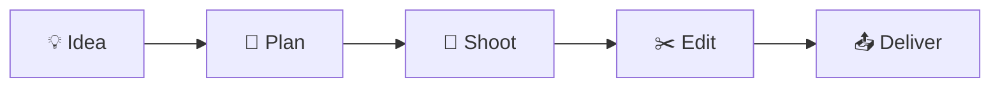

| Scale | Example | Crew |
|---|---|---|
| Solo | Phone clip for social media | 1 person |
| Small | YouTube tutorial, interview | 1–3 people |
| Large | Documentary, commercial | Dozens |

---

### 1.2 The Production Pipeline

Projects move through pre-production (script, storyboard, planning), production (shooting), post-production (editing, color, sound, graphics), and delivery (export and publishing). Good planning early makes every later stage easier.

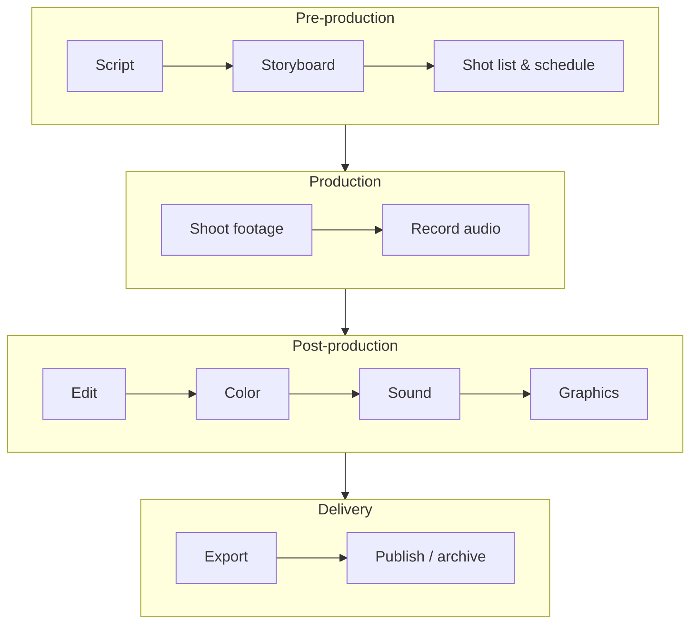

**Sample shot list:**

| # | Shot | Type | Notes |
|---|---|---|---|
| 1 | Exterior of shop | Wide | Golden hour |
| 2 | Owner opens the door | Medium | Follow movement |
| 3 | Hands crafting product | Close-up | Slow motion (60 fps) |
| 4 | Owner talks to camera | Medium close-up | Lavalier mic |

---

### 1.3 Frame Rate, Resolution, and Aspect Ratio

Frame rate is images per second (24 fps looks cinematic, 30 fps is common for web, 60 fps is smooth for action). Resolution is frame size, such as 1920 × 1080 (Full HD) or 3840 × 2160 (4K). Aspect ratio is the shape of the frame, such as 16:9 for widescreen or 9:16 for vertical video.

```
 16:9 (widescreen)      9:16 (vertical)     1:1 (square)    2.39:1 (cinema)
 ┌──────────────┐       ┌────┐              ┌──────┐        ┌────────────────┐
 │              │       │    │              │      │        └────────────────┘
 │              │       │    │              │      │
 └──────────────┘       │    │              └──────┘
                        └────┘
 YouTube, TV            Reels, TikTok       Feed posts      Film
```

| Frame rate | Look | Use |
|---|---|---|
| 24 fps | Cinematic | Film, narrative |
| 30 fps | Natural | Web, interviews |
| 60 fps | Very smooth / slow-mo option | Sports, action |

| Resolution | Pixels | Name |
|---|---|---|
| 1280 × 720 | 0.9 MP | HD |
| 1920 × 1080 | 2.1 MP | Full HD |
| 3840 × 2160 | 8.3 MP | 4K UHD |

> [!TIP]
> **Shoot at 60 fps and play back at 24/30 fps** to get smooth slow motion (60 ÷ 24 = 2.5× slower).

---

### 1.4 Codecs and Containers

A codec compresses the video and audio (for example H.264 or ProRes), and a container wraps them into one file (for example MP4 or MOV). Camera codecs favor quality, and delivery codecs favor small size.

```
 ┌───────────── container: .mov / .mp4 ─────────────┐
 │  🎞 video  → codec (H.264 / ProRes / H.265)       │
 │  🔊 audio  → codec (AAC / PCM)                    │
 │  🏷 metadata (timecode, title, duration)           │
 └───────────────────────────────────────────────────┘
```

| Codec | Typical use | File size | Editing smoothness |
|---|---|---|---|
| H.264 | Delivery, phone cameras | Small | Heavier on CPU |
| H.265 (HEVC) | 4K delivery | Smaller | Heavier on CPU |
| ProRes | Editing, masters | Large | Very smooth |

---

*Basics*

## Lesson 2 - Organizing Footage

### 2.1 Importing and Naming Media

Copy footage from cameras into a clear folder structure before you start editing. Use consistent names that include the date or scene so clips are easy to find later.

```
 2025-02-03_ShopDocumentary/
 ├── 01_Footage/
 │   ├── CamA/   A001_C001.mp4, A001_C002.mp4 …
 │   └── CamB/   B001_C001.mp4 …
 ├── 02_Audio/
 │   └── interview_lav_01.wav
 ├── 03_Music/
 ├── 04_Graphics/
 ├── 05_Project/
 └── 06_Exports/
```

| ❌ Unhelpful | ✅ Helpful |
|---|---|
| `IMG_0042.MOV` | `2025-02-03_shop-exterior_wide_01.mov` |
| `final-FINAL-v3.mp4` | `shop-doc_v03_2025-02-10.mp4` |

---

### 2.2 Bins, Folders, and Metadata

Inside the editor, group clips into bins by scene, camera, or type (footage, music, graphics). Labels, ratings, and markers help you quickly pick the best takes.

```
 📁 Project panel
 ├── 📁 Footage
 │   ├── 📁 Scene 01 – Exterior       ⭐⭐⭐ best take labeled
 │   ├── 📁 Scene 02 – Interview
 │   └── 📁 B-roll
 ├── 📁 Audio
 │   ├── 🎤 Dialogue
 │   └── 🎵 Music
 ├── 📁 Graphics
 └── 📁 Sequences
```

| Tool | Use |
|---|---|
| Color labels | Visually group by scene / camera |
| Star ratings | Mark your favorite takes |
| Markers | Flag moments inside a clip |
| Keywords | Search clips quickly |

---

### 2.3 Proxies and Performance

Proxies are small, lightweight copies of large files that make editing smooth on modest computers. The editor swaps back to the original quality when you export.

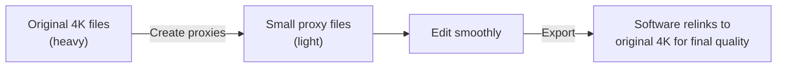

| | Originals | Proxies |
|---|---|---|
| Resolution | 4K | 720p / 1080p |
| Size | Huge | Small |
| Editing speed on a modest PC | Laggy | Smooth |
| Export quality | ✅ Used | ❌ Not used |

---

### 2.4 Backups and Storage

Keep at least two copies of all footage and projects, ideally on separate drives. Video files are large, so plan storage space before the project begins.

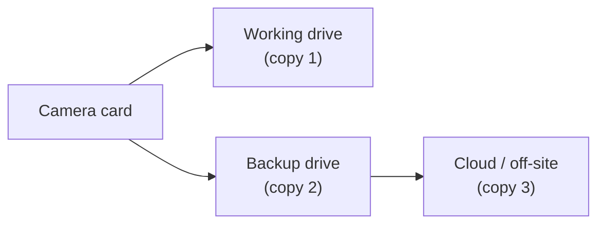

> [!NOTE]
> **3-2-1 rule:** keep **3** copies, on **2** different types of media, with **1** off-site. Don't format the camera card until all copies are verified.

| Footage | Approx. storage per hour |
|---|---|
| 1080p H.264 (phone) | ~6–10 GB |
| 4K H.264 | ~20–40 GB |
| 4K ProRes 422 | ~200+ GB |

---

*Basics*

## Lesson 3 - Editing Fundamentals

### 3.1 The Timeline and Tracks

The timeline is where clips are arranged in order over time. Video and audio live on separate tracks, and clips on higher video tracks appear over those below.

```
 Timeline ▶  00:00        00:05        00:10        00:15
 ──────────────────────────────────────────────────────────
 V3  Titles       │      [ Title ]         [ Lower third ]
 V2  B-roll       │   [ B-roll ]   [ B-roll ]
 V1  Main footage │[ Interview ──────][ Interview ──────]
 ──────────────────────────────────────────────────────────
 A1  Dialogue     │▃▆█▆▃▅▇▅▃▂▃▆█▆▃▅▇▅▃
 A2  Music        │▂▂▂▂▂▂▂▂▂▂▂▂▂▂▂▂▂▂▂▂   (lowered)
 A3  SFX          │     ◆ whoosh      ◆ ding
```

> [!TIP]
> Higher video tracks sit **on top**: V2 covers V1. Put titles at the top and your main footage at the bottom.

---

### 3.2 Cuts, Trims, and Transitions

A cut joins two clips instantly. Trimming adjusts where a clip starts and ends. Transitions such as dissolves soften the change, but straight cuts are usually the cleanest choice.

```
 Cut:        [ Clip A ][ Clip B ]           instant change
 Dissolve:   [ Clip A ▒▒][▒▒ Clip B ]       blend over a short overlap
 Trim:       [ Clip A ◄─── ───►]            drag edges to shorten / lengthen
```

| Transition | Meaning / use |
|---|---|
| Cut | Default, same scene continuing |
| Dissolve / cross-fade | Passage of time, gentle change |
| Dip to black | End of a section or scene |
| Wipe / slide | Stylized, use sparingly |

| Edit type | Description |
|---|---|
| Ripple | Trimming closes gaps automatically |
| Roll | Moves the cut point between two clips (total length unchanged) |
| Slip | Changes which part of a clip is shown (clip stays in place) |

---

### 3.3 Pacing and Storytelling

Pacing is the rhythm of cuts. Fast cuts raise energy, and longer shots create calm. Cut on action, remove dead space, and make sure each shot earns its place in the story.

```
 Fast pacing:  |▏|▏|▏|▏|▏|▏|▏|▏|    shots of 1–2 s → energetic, trailers
 Slow pacing:  |▏        |▏        |   shots of 6–10 s → calm, reflective
```

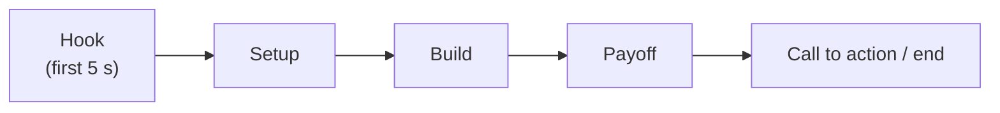

| Shot size | Shows | Use |
|---|---|---|
| Wide | Setting | Establish a place |
| Medium | Waist up | Conversation |
| Close-up | Face / detail | Emotion, emphasis |

---

### 3.4 Working With Multiple Cameras

Multi-camera editing syncs footage from several angles, often using audio, so you can switch between them. It adds variety to interviews, events, and podcasts.

```
 Cam A (wide)    ▓▓▓▓▓▓▓▓▓░░░░▓▓▓▓▓▓▓▓░░░░░░▓▓▓▓▓
 Cam B (host)    ░░░░░░░░░▓▓▓▓░░░░░░░░▓▓▓░░░░░░░░░
 Cam C (guest)   ░░░░░░░░░░░░░░░░░░░░░░░░▓▓▓░░░░░░░
 Edit (cuts)     [ A ─────][B ][ A ──────][B][C ][A ]
                 (switch live while the clip plays)
```

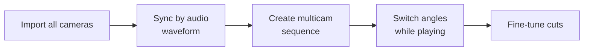

---

*Practice*

## Lesson 4 - Audio In Video

### 4.1 Dialogue, Music, and Effects

Most videos combine dialogue, music, and sound effects. Dialogue should be clear first, music supports the mood, and effects add realism and emphasis.

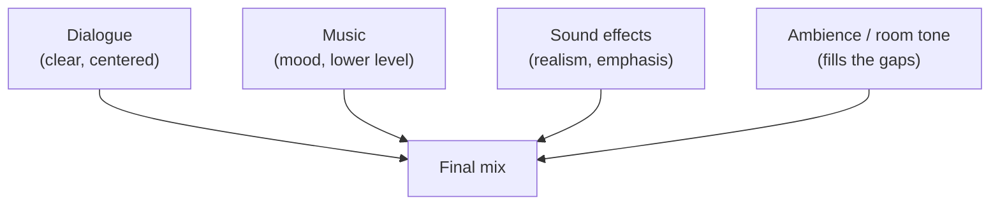

| Layer | Purpose | Priority |
|---|---|---|
| Dialogue | Carries information | ⭐⭐⭐ |
| Music | Emotion and pace | ⭐⭐ |
| Effects | Realism and emphasis | ⭐⭐ |
| Ambience | Natural feel | ⭐ |

---

### 4.2 Levels and Ducking

Set dialogue at a steady level and lower the music under it. Ducking automatically reduces music volume while someone is speaking and raises it again in the gaps.

```
 Dialogue: ▁▁▇▇▇▇▇▁▁▁▁▇▇▇▇▇▁▁
 Music:    ████▃▃▃▃▃████▃▃▃▃▃████   ← ducks while speaking
           full  low  full  low  full
```

| Element | Typical peak level |
|---|---|
| Dialogue | -12 to -6 dB |
| Music (under speech) | -24 to -18 dB |
| Music (no speech) | -14 to -8 dB |
| Sound effects | -18 to -10 dB |

---

### 4.3 Syncing Audio and Video

When audio is recorded separately, line it up with the video using a clap, a waveform match, or automatic sync. Out-of-sync audio is quickly noticed by viewers.

```
 Camera audio (scratch):  ▁▁▁▁▁▁█▅▂▁▃▆█▆▃        ← clap spike
 Recorder audio (good):        ▁▁▁▁█▅▂▁▃▆█▆▃    ← clap spike
                                    ▲
                          align the spikes, then mute camera audio
```

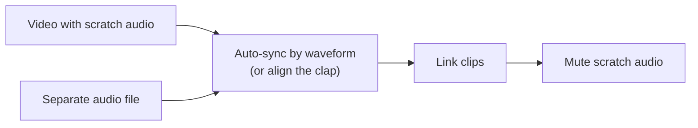

---

### 4.4 Cleaning Up Audio

Reduce background noise, remove clicks, and use EQ to make speech clearer. Aim for dialogue that is consistent from clip to clip.

| Problem | Typical fix |
|---|---|
| Constant hiss or hum | Noise reduction, hum notch filter |
| Boomy voice | Cut low frequencies (80–200 Hz) |
| Harsh "s" sounds | De-esser or EQ cut at 6–8 kHz |
| Echo | Reduce with a de-reverb effect, or re-record |
| Uneven volume between clips | Normalize, then adjust clip gain |

> [!TIP]
> Record a few seconds of **room tone** (silence on location). It makes noise reduction work better and lets you fill gaps seamlessly.

---

*Practice*

## Lesson 5 - Color And Graphics

### 5.1 Color Correction vs Color Grading

Color correction fixes problems, such as exposure and white balance, so footage looks natural and matches between shots. Color grading is the creative step that sets a mood or style. Always correct first, then grade.

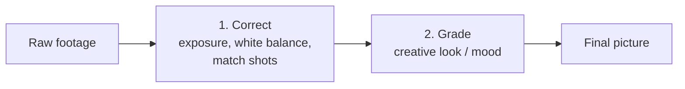

| | Correction | Grading |
|---|---|---|
| Goal | Make it look natural / consistent | Make it look stylish / emotional |
| Example | Fix a too-blue shot | Warm sunset look; teal-and-orange |
| Order | First | Second |

| Tool | Controls |
|---|---|
| Exposure / Contrast | Brightness and punch |
| White balance | Cool ↔ warm, green ↔ magenta |
| Saturation | Color intensity |
| Curves / Wheels | Shadows, midtones, highlights |
| Scopes (waveform, vectorscope) | Objective measurement |

---

### 5.2 Titles and Lower Thirds

Titles introduce the video, and lower thirds label speakers or locations. Keep text large enough to read, inside safe margins, and on screen long enough to finish reading.

```
 ┌────────────────────────────────────────┐
 │ ┌────────────────────────────────────┐ │ ◄ title-safe area (~90%)
 │ │                                    │ │
 │ │                                    │ │
 │ │                                    │ │
 │ │  ┃ JANE DOE                        │ │
 │ │  ┃ Owner, Sunrise Bakery           │ │ ◄ lower third (bottom-left)
 │ └────────────────────────────────────┘ │
 └────────────────────────────────────────┘
```

| Rule | Guideline |
|---|---|
| Minimum text size (1080p) | ~48 px for titles, ~32 px for lower thirds |
| On-screen time | ~0.3 s per word, minimum 3–4 s |
| Contrast | Light text on dark or add a subtle shadow/box |
| Position | Keep within safe margins, avoid platform UI overlays |

---

### 5.3 Basic Effects and Keyframes

Keyframes animate properties such as scale, position, or opacity over time. Simple effects like zooms, speed changes, and blurs add polish when used with restraint.

```
 Slow push-in (Scale keyframes)
 Scale  ◆ 100%  ─────────────►  ◆ 110%
        0:00                      0:06
        wide       slowly         tighter
        frame      zooming        frame
```

| Effect | Use |
|---|---|
| Slow zoom (Ken Burns) | Bring life to still photos |
| Speed ramp | Emphasize action |
| Blur / mosaic | Hide faces, license plates |
| Stabilization | Smooth shaky handheld shots |

---

### 5.4 Green Screen Basics

Green screen footage lets you replace the background by removing the green color (keying). Light the screen evenly and keep subjects away from it to avoid green spill on their edges.

```
 Shoot:                      Key:                    Composite:
 ┌──────────────┐            ┌──────────────┐        ┌──────────────┐
 │ 🟩🟩 🧍 🟩🟩│  key out → │ ░░░ 🧍 ░░░  │  over →│ 🏔 🧍  🏔    │
 │ 🟩🟩🟩🟩🟩🟩│  green     │ (transparent)│  new   │ new background│
 └──────────────┘            └──────────────┘  BG    └──────────────┘
```

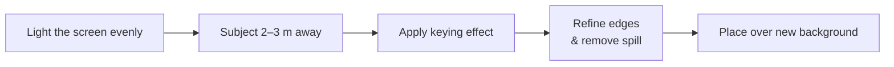

> [!TIP]
> Avoid green clothing, keep the screen wrinkle-free, and light the **subject** separately from the **screen**.

---

*Ecosystem*

## Lesson 6 - Exporting And Delivery

### 6.1 Export Settings and Presets

Use a preset for your destination, then check resolution, frame rate, and bitrate. Match the project's settings unless the platform requires something different.

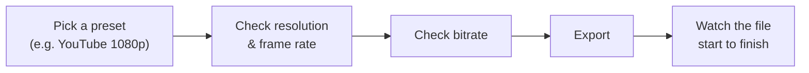

| Setting | Typical choice (1080p web) |
|---|---|
| Format / codec | MP4 · H.264 |
| Resolution | 1920 × 1080 |
| Frame rate | Same as the project |
| Bitrate | 8–16 Mbps (VBR) |
| Audio | AAC · 48 kHz · 192–320 kbps |

> [!NOTE]
> **File size (MB) ≈ (video bitrate + audio bitrate in Mbps) × seconds ÷ 8.** A 5-minute video at 10 Mbps ≈ **375 MB**.

---

### 6.2 Formats for YouTube, Social, and Broadcast

H.264 MP4 works for YouTube and most social platforms. Vertical formats suit short-form video, and broadcast deliveries often require specific codecs and loudness levels, so check the requirements.

| Destination | Aspect | Resolution | Format |
|---|---|---|---|
| YouTube | 16:9 | 1920 × 1080 / 3840 × 2160 | MP4 (H.264) |
| Reels / TikTok / Shorts | 9:16 | 1080 × 1920 | MP4 (H.264) |
| Instagram feed | 4:5 or 1:1 | 1080 × 1350 / 1080 × 1080 | MP4 (H.264) |
| Broadcast TV | 16:9 | Per spec | Often ProRes / MXF + loudness spec |

> [!NOTE]
> Platform specs change often. Check each platform's current upload guidelines before exporting.

---

### 6.3 Subtitles and Captions

Captions make videos accessible and work when sound is off. Add them as a separate file for platforms that support it, or burn them into the picture for social clips.

**Sample SRT subtitle file:**

```text
1
00:00:01,000 --> 00:00:03,500
Welcome to Sunrise Bakery.

2
00:00:03,800 --> 00:00:07,000
Every loaf is baked fresh before dawn.
```

| | Sidecar file (SRT/VTT) | Burned-in (open) captions |
|---|---|---|
| Viewer can turn off | ✅ | ❌ |
| Works on every platform | Platform-dependent | ✅ |
| Style control | Limited | Full |
| Best for | YouTube, web | Social clips |

---

### 6.4 Archiving Projects

Save the project file, source media, and final export together in one organized folder. Label it clearly so the project can be reopened or reused years later.

```
 Archive_ShopDoc_2025-02/
 ├── ShopDoc_FINAL_1080p.mp4      ← deliverable
 ├── ShopDoc_Master_ProRes.mov    ← high-quality master
 ├── Project/
 │   └── ShopDoc.prproj           ← project file
 ├── Media/                       ← all source footage & audio
 ├── Graphics_Music_Licenses/     ← assets + license proofs
 └── README.txt                   ← software version, notes
```

---

*Ecosystem*

## Lesson 7 - Choosing A Video Editor

### 7.1 Editing vs Color vs Effects Workflows

Some editors focus on fast cutting, others on deep color work, and others on effects. Choose based on what your projects need most, and note that all-in-one programs reduce the need to move files between apps.

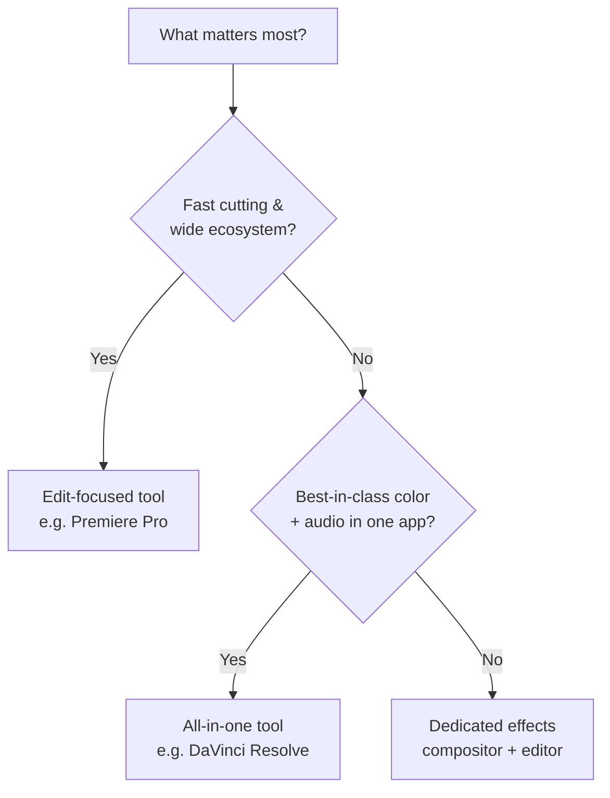

| Workflow | Strength |
|---|---|
| Edit | Speed, organization, storytelling |
| Color | Look, consistency, mood |
| Effects / motion | Titles, compositing, VFX |
| Audio | Dialogue cleanup, mixing |

---

### 7.2 Free vs Paid Software

Capable free editors exist and are enough to learn on and to produce good work. Paid editors add integrations, team features, and industry-standard workflows.

| | Free options | Paid options |
|---|---|---|
| Cost | $0 | Subscription / one-time |
| Good for learning | ✅ | ✅ |
| Team collaboration | Limited | Strong |
| Plugin / ecosystem support | Good | Very broad |
| Watermark-free export | Usually yes | Yes |

---

### 7.3 Hardware Considerations

Editing benefits from a fast processor, a good graphics card, plenty of memory, and quick storage. Using proxies lets modest machines handle large footage.

| Component | Why it matters | Starting point |
|---|---|---|
| CPU | Playback, H.264/H.265 decoding | 6+ cores |
| GPU | Effects, color, export speed | Dedicated GPU, 6+ GB VRAM |
| RAM | Multi-layer timelines | 16 GB (32 GB for 4K) |
| Storage | Smooth scrubbing | SSD for active projects |
| Display | Accurate color | Calibrated, wide-gamut ideal |

```
 Bottleneck check
 Choppy playback? → use proxies  → still slow? → upgrade GPU / RAM / SSD
```

---

### 7.4 Where to Go Next

Open the Premiere Pro or DaVinci Resolve file in this topic and edit a 60-second video with cuts, music, and a title. Then add color correction and export it for the web.

